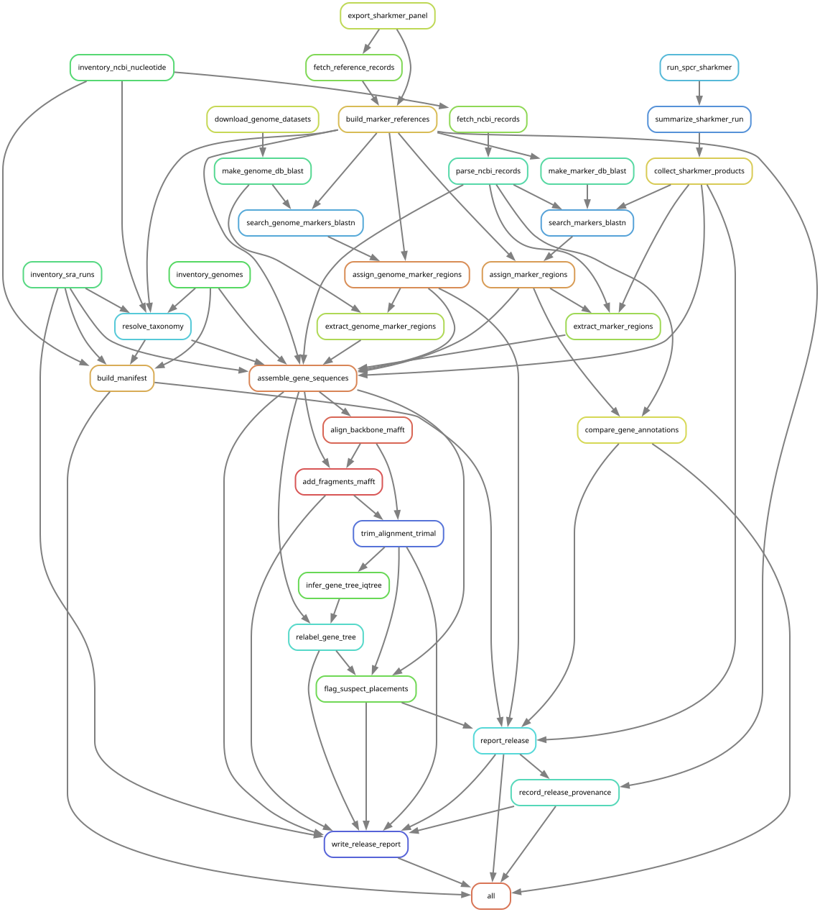

# siph-seq: an inventory of public siphonophore sequence data

This repository builds a regularly updated catalogue of all publicly available
DNA and RNA sequence data for siphonophores (Siphonophorae, NCBI taxid 42759).
It runs a few basic analyses on that catalogue. It answers three questions:

1. **What public data exist?** A manifest lists every GenBank nucleotide
   record, SRA sequencing run, and genome assembly for siphonophores.
2. **Which genes do they contain?** Gene sequences are identified by
   similarity to reference sequences, and each one gets a name from a
   consistent gene vocabulary. Read data and genomes are mined for the common
   marker genes (nuclear 18S and 28S rRNA, mitochondrial 16S rRNA and CO1).
3. **Are the species identifications plausible?** One gene tree per marker
   combines all sources. Sequences that fall far from their own genus or
   family in the tree are flagged as possible misidentifications or
   contamination.

No manuscript accompanies this repository yet.

## What the workflow does

Each run of the workflow builds a **release**: a snapshot of the public
databases on a given date, named by that date (e.g. `2026-11-18`).

| Data source | How it is obtained | What is done with it |
| --- | --- | --- |
| GenBank nucleotide records (genes, rDNA, mitochondrial genomes) | E-utilities query `txid42759[Organism:exp]` | Records are downloaded. Genes are identified by BLAST similarity to reference markers. Submitter annotations are normalized to the gene vocabulary and compared with the similarity result. |
| SRA runs (genome and transcriptome reads) | ENA portal API (ENA mirrors SRA) | [sharkmer](https://github.com/caseywdunn/sharkmer) streams the first 2 million reads from ENA and assembles 16S, CO1, 18S and 28S by *in silico* PCR with its `hydrozoa` primer panel. |
| Genome assemblies | NCBI Datasets | Assemblies are downloaded. The four marker genes are found by BLAST. Up to three best-matching copies of 18S and 28S are extracted, and the single best copy of 16S and CO1. |

Then, for each of 18S, 28S, 16S and CO1, sequences from all three sources
are combined, and a maximum-likelihood tree is inferred with IQ-TREE 3, with
non-siphonophore hydrozoan sequences as outgroups. Short barcodes (100 bp and
longer) are included. Near full-length sequences are aligned first with
MAFFT; shorter ones are then added to that alignment as fragments (MAFFT
`--addfragments`). trimAl chooses the well-aligned columns using the
near full-length sequences only, so that the regions covered by barcodes
are not discarded as gappy. In each tree, every siphonophore sequence is compared with its
five nearest neighbours from other datasets. The comparison is described
under [Interpreting suspect placements](#interpreting-suspect-placements).

**Rerunning.** Each downloaded record, sharkmer run and genome is stored once
by its versioned accession and is never recomputed. A new release therefore
re-queries the databases but only processes datasets that are new. A rerun
of the same release resumes it. Inventories, trees and reports for each
release are kept separately under `results/releases/<release>/`.

## Main results

### Release reports

Each release ends with a report for sharing, in [`reports/`](reports/).
`reports/<release>/README.md` explains the screen and its outcomes in plain
language. It gives the methods and settings, lists every flagged dataset with
links to its NCBI and ENA records, and gives the evidence for each flag:
placement statistics and a figure of the dataset's neighbourhood in the gene
tree. The trees, alignments and tables behind it are in
`reports/<release>/data/`, so a link to the report gives readers everything.
[`reports/README.md`](reports/README.md) lists all releases.

The report is the only part of a release kept under version control. To
publish one, commit `reports/<release>/` and `reports/README.md` after the
release finishes. Each report records the workflow commit that produced it,
so commit any code changes before building the release.

### Full release outputs

The workflow's complete outputs are not version-controlled. All paths are
relative to `results/releases/<release>/`.

| File | Contents |
| --- | --- |
| `manifest.tsv` | Every public dataset, with source, accession, data type, platform, NCBI taxonomy, size, date and voucher. It also says whether the dataset was processed and why or why not. |
| `reports/dataset_status.tsv` | The manifest plus each dataset's outcome: genes recovered, genes placed in trees, and suspect-placement flags. |
| `reports/dataset_flags.tsv` | Datasets with at least one suspect placement, strongest first. |
| `reports/suspect_placements.tsv` | Every sequence's placement evaluation in every gene tree. |
| `reports/summary.tsv` | Counts by data source and outcome. |
| `ncbi/gene_assignments.tsv` | For each GenBank record, the gene(s) it contains, with coordinates, evidence (similarity, annotation, or both), whether the annotation agrees, and ontology identifiers. |
| `ncbi/record_genes.tsv` | One row per GenBank record summarizing its genes and any conflict between similarity and annotation. |
| `sra/run_status.tsv`, `sra/products.tsv` | sharkmer outcome per run and gene, and every recovered product. |
| `trees/<gene>/tree.nwk` | Gene tree (Newick, with ultrafast bootstrap support). Tip labels are `Genus_species@<source>-<accession>`, with source `ncbi`, `sra`, `genome` or `ref` (outgroup reference). |
| `trees/<gene>/tip_metadata.tsv` | Every candidate sequence for the tree: its taxonomy, length, and whether it is in the alignment backbone or a short fragment. If a sequence was left out, the reason is given. |
| `trees/<gene>/aligned_sites.tsv` | Number of aligned sites each sequence keeps after trimming. |
| `release_record.yaml` | Software versions, git commit and configuration that produced the release. |

Data shared across releases are stored by accession: `data/ncbi_nucleotide/`
holds GenBank flat files, `data/genomes/<assembly>/` holds genomes,
`results/sharkmer/<run>/` holds sharkmer outputs, and
`results/genomes/<assembly>/` holds extracted marker genes.

### Gene vocabulary

GenBank records name the same gene in many ways (`cox1`, `COI`,
`cytochrome c oxidase subunit I`; `rnl`, `rrnL`, `16S ribosomal RNA`).
[`config/gene_vocabulary.tsv`](config/gene_vocabulary.tsv) defines one short
`gene_id` per gene, such as `18S`, `28S`, `16S`, `CO1` or `ND4L`. Each one is
linked to a [Sequence Ontology](http://www.sequenceontology.org/) term and,
where one exists, the HGNC symbol of the human counterpart (e.g. `CO1` is
`SO:0001217` protein_coding_gene and `MT-CO1`; `18S` is `SO:0002236`
cytosolic_rRNA_18S_gene and `RNA18SN5`). The table also holds the patterns
used to recognize each gene in annotations. Labels such as "large subunit
ribosomal RNA" are resolved by compartment: 28S for nuclear records, 16S for
mitochondrial ones.

### Interpreting suspect placements

For each siphonophore sequence in a gene tree, the workflow finds its five
nearest sequences by branch-length distance, plus any that are equally close.
Sequences from the same dataset, such as several sharkmer products from one
run, are ignored.

The genes differ in what they can resolve. Nuclear 18S and 28S rRNA evolve
slowly in siphonophores, so different genera often have identical or nearly
identical sequences. These genes are checked at family level only, and they
give no species-level evidence. Mitochondrial 16S and CO1 evolve faster and
are checked at genus and family level. A mismatch is flagged only when the
gene actually resolves it. The nearest sequence of the same genus (or
family) must be clearly farther away than the nearest neighbour: at least
0.02 substitutions/site for 16S and CO1, and 0.01 for 18S and 28S. The ranks
and distances are set per gene in `config/config.yaml`.

Each sequence gets one outcome:

- `genus_mismatch`: other datasets of the same genus are in the tree, none is
  among the nearest neighbours, and the gene resolves the difference.
- `family_mismatch`: the same test at family level. This is a stronger signal.
- `outside_focal_clade`: most neighbours are not siphonophores, or the
  nearest one is not and every siphonophore is clearly farther. This usually
  means contamination (e.g. prey or symbionts in the reads, or foreign DNA in
  an assembly) or a non-siphonophore sample.
- `unresolved`: the sequence's genus or family is not among its neighbours,
  but too little sequence divergence separates them to tell.
- `consistent`.
- `not_evaluable`: the sequence is the only one of its genus and family in
  the tree.
- `not_in_tree`: the sequence kept fewer than 80 aligned sites after trimming.

Each evaluation reports the sequence's `length` and `aligned_sites`. The
placement of a short barcode rests on few sites, so its flags are weaker
evidence than those of a full-length sequence.

This is a screening tool for manual review, not a test. Flags also arise from
genera that are not monophyletic, sparse sampling, short partial sequences,
and poorly resolved trees. When only two datasets of a family disagree, both
are flagged, because the tree alone cannot say which one is wrong. The most
reliable evidence of a misidentified sample is a dataset flagged in several
genes, especially in 16S or CO1, or flagged at family level.
`dataset_flags.tsv` lists these first. A flag marked "(another copy
consistent)" means the dataset also has a copy of that gene that sits with
its own taxon. This points to foreign DNA in the reads or assembly, not a
wrong species name.

## Running the workflow

### Setup (once)

From the repository root, on the Misha cluster (or any SLURM cluster):

```bash
module load miniconda
conda env create -f environment.yml -p /gpfs/radev/project/dunn/cwd7/conda_envs/siph-seq
conda activate /gpfs/radev/project/dunn/cwd7/conda_envs/siph-seq
```

Optionally set an [NCBI API key](https://support.nlm.nih.gov/kbArticle/?pn=KA-05317)
with `export NCBI_API_KEY=...`, which makes NCBI queries faster. Everything
else is downloaded by the workflow.

### Build a release

Run Snakemake from a login node or an interactive session inside `tmux`. It
submits each job to SLURM:

```bash
conda activate /gpfs/radev/project/dunn/cwd7/conda_envs/siph-seq
scripts/run_release.sh            # release named by today's date
scripts/run_release.sh 2026-11-18 # resume or rebuild a specific release
```

This is equivalent to:

```bash
snakemake all --snakefile workflow/Snakefile --configfile config/config.yaml \
  --config release=2026-11-18 --profile workflow/profiles/slurm
```

Preview the jobs without running them (a dry run):

```bash
snakemake all --snakefile workflow/Snakefile --configfile config/config.yaml \
  --config release=2026-11-18 --profile workflow/profiles/slurm --dry-run
```

The dry run lists only the jobs it can see before the SRA and genome
inventories exist. Per-run and per-genome jobs are added once those
inventories are written.

Other targets select parts of the analysis and build anything they need
upstream. `inventory` builds only the manifest, and `trees` builds the gene
trees without the reports. To run on the current machine instead of SLURM,
replace `--profile workflow/profiles/slurm` with
`--profile workflow/profiles/local`.

**Pilot run.** [`config/pilot.yaml`](config/pilot.yaml) limits a release to
three SRA runs and the smallest genome. It runs the same workflow:

```bash
snakemake all --snakefile workflow/Snakefile --configfile config/config.yaml config/pilot.yaml \
  --config release=pilot --profile workflow/profiles/slurm
```

**Cost of a full first release.** About 450 SRA runs at roughly 3 minutes and
9 GB of memory each, and seven genome assemblies of 0.9 to 4.4 Gb. Each
genome needs a download, a BLAST database and a BLAST search, which takes
roughly 1 to 3 hours. Later releases process only new datasets.

**Cluster submission limits.** YCRC allows 200 job submissions per user per
hour. The workflow stays under this: light steps run inside the Snakemake
process, and cluster jobs are submitted at no more than 3 per minute. A first
release with about 450 SRA runs therefore takes at least 2.5 hours just to
submit. Avoid running two releases at once.

**Interrupted runs.** If Snakemake was stopped abruptly, the next launch may
report that the directory "cannot be locked". Check that no other Snakemake is
running for this repository, then add `--unlock` to the launch command once,
and relaunch.

**Failed sharkmer runs.** Runs that fail, for example because ENA cannot be
reached, are recorded as `failed` in `sra/run_status.tsv`. They do not stop
the release. To retry them, run `python scripts/clear_failed_sharkmer_runs.py`.
The next release retries them automatically. To retry them within an existing
release instead, relaunch it with
`scripts/run_release.sh <release> --forcerun collect_sharkmer_products`.
Without `--forcerun`, Snakemake sees that the release's results already exist
and does nothing.

### Settings

All settings are in [`config/config.yaml`](config/config.yaml), with comments:
the taxon, which SRA platforms and library types to analyse, reads per run,
the sharkmer panel, reference records for gene identification, tree
settings, and neighbour-count for flagging. The taxid is checked against the
taxon name at every query, so a wrong taxid stops the workflow.

### Workflow structure



Generated from `workflow/Snakefile`, `config/config.yaml`, target `all`,
with one example SRA run and one example genome standing in for the
per-dataset jobs. Regenerate with `./scripts/update-rulegraph.sh`. Each stage is described at
the top of its rule file in [`workflow/rules/`](workflow/rules/).

## Limitations

- sharkmer has no siphonophore-specific primer panel. The `hydrozoa` panel
  (v1.0.9) is used. Its CO1 (Folmer) primers recover CO1 from only some
  hydrozoans, and 16S recovery varies (see the panel notes, via
  `sharkmer --export-panel hydrozoa`). Two million reads suffice for
  high-copy rRNA and mitochondrial genes, but not always.
- Long-read (PacBio, Nanopore), SOLiD, 454 and Helicos runs are inventoried
  but not analysed, because sharkmer needs accurate short reads.
- Genes outside the reference set (e.g. nuclear protein-coding genes other
  than EF1A, and ITS) are identified from annotations or titles only. Their
  `evidence` column says so.
- Up to three copies of 18S and 28S are extracted per genome assembly (the
  best BLAST matches), because the best match is sometimes contaminant rDNA
  from another organism. Contaminant copies are flagged in the trees, and the
  flag notes when another copy from the same assembly placed as expected. A
  flag on a genome therefore often means contamination, not a misidentified
  species.
- Only the best match is kept for 16S and CO1. Lower-ranked matches were
  mostly nuclear copies of mitochondrial genes (NUMTs) or spurious fragments.
  If an assembly lacks its mitochondrial genome, even the best match can be a
  NUMT.
- Datasets published only outside NCBI and ENA are not included.
