# Siphonophore public sequence data: identity screen, release 2026-11-18

This report screens all public sequence data for siphonophores (Siphonophorae, NCBI Taxonomy ID 42759) for datasets whose species label disagrees with where their marker genes fall in gene trees. It covers GenBank nucleotide records, raw reads in the Sequence Read Archive (SRA), and genome assemblies, as listed by NCBI and ENA on 2026-11-18.

**23 datasets are flagged.** A flag means that a sequence from the dataset is surrounded in a gene tree by sequences of a different genus, family, or by non-siphonophores, while sequences of its own genus or family are present elsewhere in the tree. Possible causes are a misidentified specimen, contamination, a sample or file mix-up, or a problem with the reference sequences it was compared with. A flag is a reason to look at a dataset, not a conclusion: see [How to read a flag](#how-to-read-a-flag). Each flagged dataset has its own section below with the evidence.

## Contents

- [Summary](#summary)
- [Flagged datasets](#flagged-datasets)
- [How to read a flag](#how-to-read-a-flag)
- [Methods](#methods)
- [Unresolved placements](#unresolved-placements)
- [Coverage](#coverage)
- [Files](#files)
- [Provenance](#provenance)

## Summary

| Source | Datasets listed | Processed | With marker genes | In a gene tree | Flagged | Failed |
|---|---|---|---|---|---|---|
| GenBank records | 1990 | 1928 | 1911 | 1735 | 20 | 0 |
| SRA runs | 532 | 454 | 284 | 264 | 2 | 3 |
| Genome assemblies | 7 | 7 | 7 | 7 | 1 | 0 |

Sequences per gene tree and how their placements were judged:

| Gene | Sequences in tree | Consistent | Other genus | Other family | Outside siphonophores | Unresolved | Not evaluable | Ranks checked |
|---|---|---|---|---|---|---|---|---|
| 18S | 914 | 879 | 0 | 2 | 0 | 9 | 24 | family |
| 28S | 305 | 286 | 0 | 9 | 1 | 6 | 3 | family |
| 16S | 714 | 704 | 2 | 4 | 0 | 1 | 3 | genus, family |
| CO1 | 883 | 869 | 5 | 3 | 1 | 1 | 4 | genus, family |

## Flagged datasets

Flagged datasets are grouped by the study they come from (publication, BioProject or submitter), so the people behind a study can find all of theirs in one place. Studies are ordered by their strongest flag. Datasets flagged in more than one gene, or with BLAST matches outside siphonophores, carry the most weight.

| Dataset | Labelled as | Study | Genes flagged | Flags | Best BLAST match |
|---|---|---|---|---|---|
| [GCA_032273505.1](#gca_0322735051) | *Nanomia bijuga* | [BioProject PRJNA894630](#study-bioproject-prjna894630) | 3 of 4 | 18S: groups with another family (another copy consistent); 28S: groups outside siphonophores (another copy consistent); CO1: groups outside siphonophores | 18S: ***Metridium senile* (cnidarian, not a hydrozoan, 100%)**; 28S: ***Clytia sp.* (hydrozoan, not a siphonophore, 97%)**; CO1: ***Clytia sp.* (hydrozoan, not a siphonophore, 92%)** |
| [SRR6178974](#srr6178974) | *Lilyopsis medusa* | [BioProject PRJNA413622](#study-bioproject-prjna413622) | 3 of 3 | 18S: groups with another family; 28S: groups with another family; CO1: groups with another genus | 18S: ***Metridium senile* (cnidarian, not a hydrozoan, 100%)**; 28S: ***Bartholomea annulata* (cnidarian, not a hydrozoan, 98%)**; CO1: ***Lebrunia neglecta* (cnidarian, not a hydrozoan, 100%)** |
| [MZ027186.1](#mz0271861) | *Apolemiidae environmental sample* | [Bergmeier et al. (2021)](#study-bergmeier-et-al-2021) | 1 of 1 | 28S: groups with another family | 28S: *Erennidae environmental sample* (siphonophore, 100%) |
| [MZ027188.1](#mz0271881) | *Apolemiidae environmental sample* | [Bergmeier et al. (2021)](#study-bergmeier-et-al-2021) | 1 of 1 | 28S: groups with another family | 28S: *Erennidae environmental sample* (siphonophore, 100%) |
| [MZ027189.1](#mz0271891) | *Hippopodiidae environmental sample* | [Bergmeier et al. (2021)](#study-bergmeier-et-al-2021) | 1 of 1 | 28S: groups with another family | 28S: *Siphonophorae sp.* (siphonophore, 100%) |
| [MZ027190.1](#mz0271901) | *Apolemiidae environmental sample* | [Bergmeier et al. (2021)](#study-bergmeier-et-al-2021) | 1 of 1 | 28S: groups with another family | 28S: *Hippopodius hippopus* (siphonophore, 98%) |
| [MZ027193.1](#mz0271931) | *Erennidae environmental sample* | [Bergmeier et al. (2021)](#study-bergmeier-et-al-2021) | 1 of 1 | 28S: groups with another family | 28S: ***Dysponetus bulbosus* (Annelida, 99%)** |
| [MZ027194.1](#mz0271941) | *Erennidae environmental sample* | [Bergmeier et al. (2021)](#study-bergmeier-et-al-2021) | 1 of 1 | 28S: groups with another family | 28S: *Apolemiidae environmental sample* (siphonophore, 100%) |
| [SRR871528](#srr871528) | *Physalia physalis* | [BioProject PRJNA205486](#study-bioproject-prjna205486) | 1 of 2 | CO1: groups with another family | CO1: ***Ferosagitta robusta* (Chaetognatha, 86%)** |
| [EU305508.1](#eu3055081) | *Kephyes ovata* | [Cartwright et al., unpublished (2007)](#study-cartwright-et-al-unpublished-2007) | 1 of 1 | 28S: groups with another family | 28S: *Physalia physalis* (siphonophore, 96%) |
| [EU448095.1](#eu4480951) | *Physalia physalis* | [Cartwright et al., unpublished (2007)](#study-cartwright-et-al-unpublished-2007) | 1 of 1 | 28S: groups with another family | 28S: *Kephyes ovata* (siphonophore, 96%) |
| [AY935305.1](#ay9353051) | *Clausophyid sp. 1 CWD-2005* | [Dunn et al. (2005)](#study-dunn-et-al-2005) | 1 of 1 | 16S: groups with another family | 16S: *Calycophorae sp. LC-2017* (siphonophore, 95%) |
| [MZ230467.1](#mz2304671) | *Dimophyes arctica* | [Park et al. (2021)](#study-park-et-al-2021) | 1 of 1 | 16S: groups with another family | 16S: *Agalma elegans* (siphonophore, 100%) |
| [PP356949.1](#pp3569491) | *Rudjakovia sp.* | [Questel et al., unpublished (2024)](#study-questel-et-al-unpublished-2024) | 1 of 1 | 16S: groups with another family | 16S: *Erenna sp. CWD-2005* (siphonophore, 90%) |
| [PP409275.1](#pp4092751) | *Lensia asymmetrica* | [Questel et al., unpublished (2024)](#study-questel-et-al-unpublished-2024) | 1 of 1 | CO1: groups with another family | CO1: no match |
| [PV190284.1](#pv1902841) | *Maresearsia praeclara* | [Submitted by Manko et al., Laboratoire de Biologie du Developpement de Villefranche-sur-mer](#study-submitted-by-manko-et-al-laboratoire-de-biologie-du-developpement-de-villefranche-sur-mer) | 1 of 1 | 16S: groups with another family | 16S: *Praya sp.* (siphonophore, 87%) |
| [OZ505748.1](#oz5057481) | *Halistemma rubrum* | [Submitted by William, Genoscope CEA](#study-submitted-by-william-genoscope-cea) | 1 of 2 | CO1: groups with another family (another copy consistent) | CO1: *Halistemma rubrum* (siphonophore, 100%) |
| [KF962059.1](#kf9620591) | *Agalma elegans* | [He et al., unpublished (2013)](#study-he-et-al-unpublished-2013) | 1 of 1 | CO1: groups with another genus | CO1: *Nanomia bijuga* (siphonophore, 100%) |
| [KF962394.1](#kf9623941) | *Agalma elegans* | [He et al., unpublished (2013)](#study-he-et-al-unpublished-2013) | 1 of 1 | 16S: groups with another genus | 16S: ***Euchaeta concinna* (Arthropoda, 100%)** |
| [KJ866199.1](#kj8661991) | *Muggiaea bargmannae* | [Licandro et al., unpublished (2014)](#study-licandro-et-al-unpublished-2014) | 1 of 1 | 16S: groups with another genus | 16S: *Lensia hostile* (siphonophore, 86%) |
| [JX121606.1](#jx1216061) | *Kephyes ovata* | [Nawrocki et al. (2013)](#study-nawrocki-et-al-2013) | 1 of 1 | CO1: groups with another genus | CO1: *Chuniphyes multidentata* (siphonophore, 100%) |
| [GQ119992.1](#gq1199921) | *Halistemma sp. BO-2021* | [Ortman et al. (2010)](#study-ortman-et-al-2010) | 1 of 1 | CO1: groups with another genus | CO1: *Stephanomia amphytridis* (siphonophore, 100%) |
| [GQ120022.1](#gq1200221) | *Halistemma sp. BO-2021* | [Ortman et al. (2010)](#study-ortman-et-al-2010) | 1 of 1 | CO1: groups with another genus | CO1: *Nanomia bijuga* (siphonophore, 100%) |

*Best BLAST match*: the closest other GenBank sequence to each flagged sequence, with its group and percent identity. Matches outside siphonophores are in bold.

### Study: BioProject PRJNA894630

BioProject PRJNA894630: genome assembly ASM3227350v1 (submitted by Iridian Genomes)

- BioProject: [PRJNA894630](https://www.ncbi.nlm.nih.gov/bioproject/PRJNA894630)
- Submitter: Iridian Genomes (2023-10-02)
- Flagged datasets: [GCA_032273505.1](#gca_0322735051)

#### GCA_032273505.1

*Nanomia bijuga* (Agalmatidae), Genome assembly.

- Record: [GCA_032273505.1](https://www.ncbi.nlm.nih.gov/datasets/genome/GCA_032273505.1/)
- Title: ASM3227350v1
- Genes in trees: 16S, 18S, 28S, CO1

All placements of this dataset's sequences (distances are along the tree, in substitutions per site):

| Gene | Copy | Placement | Length (bp) | Aligned sites | Nearest sequence | Distance | Nearest same genus | Nearest same family | Families among nearest |
|---|---|---|---|---|---|---|---|---|---|
| 18S | 1 | **groups with another family** | 1273 | 1263 | Lilyopsis medusa (SRA SRR6178974) ([link](https://www.ncbi.nlm.nih.gov/sra/SRR6178974)) | 0.0009 | not checked | 0.1275 | Pyrostephidae(3),Prayidae(1),Oceaniidae(1),Hydractiniidae(1),Rhizophysidae(1) |
| 18S | 2 | consistent | 897 | 896 | Resomia dunni (GenBank EU880273.1) ([link](https://www.ncbi.nlm.nih.gov/nuccore/EU880273.1)) | 0.0607 | not checked | 0.0613 | Agalmatidae(13),Athorybiidae(2),Resomiidae(1),unknown(1) |
| 18S | 3 | consistent | 528 | 524 | Nanomia (SRA SRR23143273) ([link](https://www.ncbi.nlm.nih.gov/sra/SRR23143273)) | 0.0000 | not checked | 0.0000 | Agalmatidae(7) |
| 28S | 1 | consistent | 2397 | 2377 | Lilyopsis medusa (SRA SRR6178974) ([link](https://www.ncbi.nlm.nih.gov/sra/SRR6178974)) | 0.0581 | not checked | 0.3870 | Apolemiidae(2),Prayidae(1),Hydractiniidae(1),Agalmatidae(1) |
| 28S | 2 | **groups outside siphonophores** | 2401 | 2372 | Clytia hemisphaerica (reference KX665495.1) | 0.0715 | not checked | 0.4702 | Apolemiidae(2),Clytiidae(1),Hydridae(1),Hydractiniidae(1),Agalmatidae(1) |
| 28S | 3 | consistent | 663 | 663 | Nanomia septata (genome GCA_048301705.1, copy 3) ([link](https://www.ncbi.nlm.nih.gov/datasets/genome/GCA_048301705.1/)) | 0.0000 | not checked | 0.0000 | Agalmatidae(10) |
| 16S | 1 | consistent | 1547 | 495 | Nanomia septata (genome GCA_048301705.1) ([link](https://www.ncbi.nlm.nih.gov/datasets/genome/GCA_048301705.1/)) | 0.0000 | 0.0000 | 0.0000 | Agalmatidae(11) |
| CO1 | 1 | **groups outside siphonophores** | 1442 | 1363 | Clytia hemisphaerica (reference GQ120065.1) | 0.0834 | 0.3804 | 0.3253 | Apolemiidae(3),Clytiidae(1),Oceaniidae(1) |

Another copy of the same gene from this dataset placed as expected. A foreign copy alongside a consistent one points to contamination in the sequenced material, not to a misidentified specimen.

Closest GenBank sequences to each flagged sequence by BLAST (core_nt, 2026-11-19), excluding this record. Groups outside siphonophores are in bold:

| Sequence | Rank | Match | Organism | Group | Identity (%) | Query coverage (%) |
|---|---|---|---|---|---|---|
| 18S copy 1 | 1 | [MT007109](https://www.ncbi.nlm.nih.gov/nuccore/MT007109) | *Metridium senile* | **cnidarian, not a hydrozoan** | 100.0 | 100 |
| 18S copy 1 | 2 | [JF832981](https://www.ncbi.nlm.nih.gov/nuccore/JF832981) | *Metridium senile lobatum* | **cnidarian, not a hydrozoan** | 100.0 | 100 |
| 18S copy 1 | 3 | [KJ483035](https://www.ncbi.nlm.nih.gov/nuccore/KJ483035) | *Metridium senile* | **cnidarian, not a hydrozoan** | 100.0 | 100 |
| 18S copy 1 | 4 | [AF052889](https://www.ncbi.nlm.nih.gov/nuccore/AF052889) | *Metridium sp.* | **cnidarian, not a hydrozoan** | 100.0 | 100 |
| 18S copy 1 | 5 | [MT007110](https://www.ncbi.nlm.nih.gov/nuccore/MT007110) | *Metridium senile* | **cnidarian, not a hydrozoan** | 100.0 | 100 |
| 28S copy 2 | 1 | [QB082031](https://www.ncbi.nlm.nih.gov/nuccore/QB082031) | *Clytia sp.* | **hydrozoan, not a siphonophore** | 97.4 | 100 |
| 28S copy 2 | 2 | [KX665489](https://www.ncbi.nlm.nih.gov/nuccore/KX665489) | *Clytia gracilis* | **hydrozoan, not a siphonophore** | 96.2 | 100 |
| 28S copy 2 | 3 | [KX665488](https://www.ncbi.nlm.nih.gov/nuccore/KX665488) | *Clytia gracilis* | **hydrozoan, not a siphonophore** | 96.1 | 100 |
| 28S copy 2 | 4 | [KX665482](https://www.ncbi.nlm.nih.gov/nuccore/KX665482) | *Clytia gracilis* | **hydrozoan, not a siphonophore** | 95.9 | 99 |
| 28S copy 2 | 5 | [KX665466](https://www.ncbi.nlm.nih.gov/nuccore/KX665466) | *Clytia elsaeoswaldae* | **hydrozoan, not a siphonophore** | 95.4 | 100 |
| CO1 copy 1 | 1 | [QB053900](https://www.ncbi.nlm.nih.gov/nuccore/QB053900) | *Clytia sp.* | **hydrozoan, not a siphonophore** | 92.4 | 100 |
| CO1 copy 1 | 2 | [QB053897](https://www.ncbi.nlm.nih.gov/nuccore/QB053897) | *Clytia hemisphaerica* | **hydrozoan, not a siphonophore** | 87.3 | 100 |
| CO1 copy 1 | 3 | [BK067244](https://www.ncbi.nlm.nih.gov/nuccore/BK067244) | *Clytia hemisphaerica* | **hydrozoan, not a siphonophore** | 87.2 | 100 |
| CO1 copy 1 | 4 | [KJ950448](https://www.ncbi.nlm.nih.gov/nuccore/KJ950448) | *Hydrozoa sp. prey of Macellomenia sp. KMK-2014* | **hydrozoan, not a siphonophore** | 86.5 | 100 |
| CO1 copy 1 | 5 | [QB053893](https://www.ncbi.nlm.nih.gov/nuccore/QB053893) | *Cosmetira pilosella* | **hydrozoan, not a siphonophore** | 86.1 | 100 |

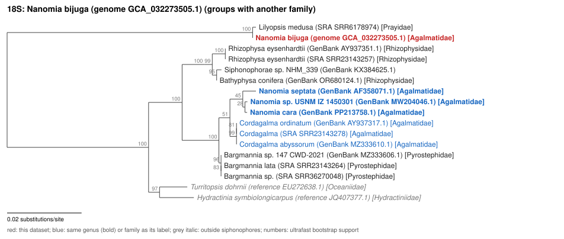

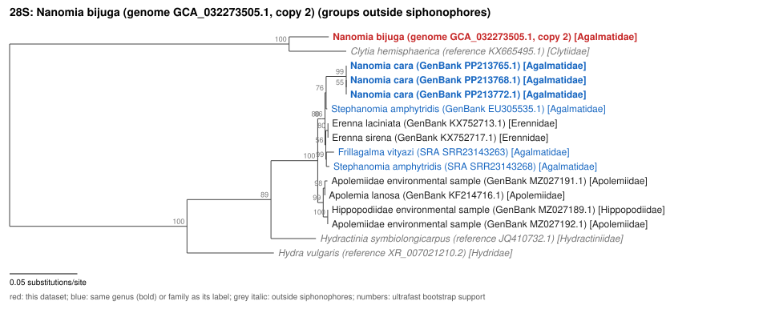

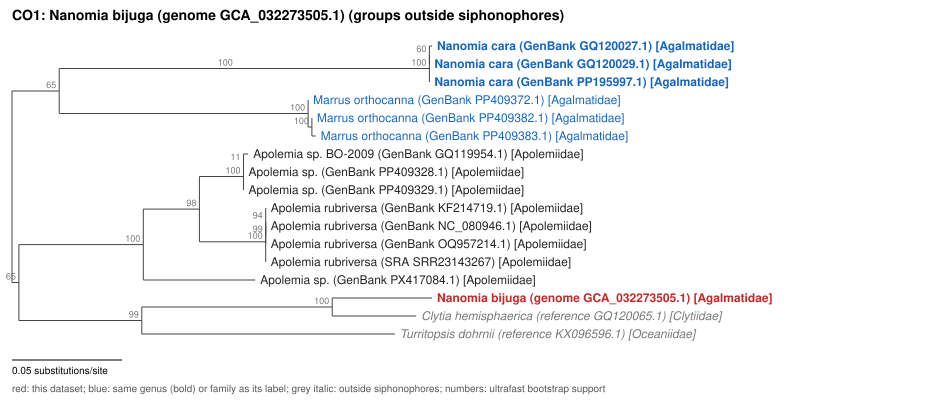

[Back to flagged datasets](#flagged-datasets)

### Study: BioProject PRJNA413622

BioProject PRJNA413622: 33 species of Anthozoa Raw sequence reads

- BioProject: [PRJNA413622](https://www.ncbi.nlm.nih.gov/bioproject/PRJNA413622)
- Flagged datasets: [SRR6178974](#srr6178974)

#### SRR6178974

*Lilyopsis medusa* (Prayidae), SRA run.

- Record: [SRR6178974](https://www.ncbi.nlm.nih.gov/sra/SRR6178974)
- ENA: [SRR6178974](https://www.ebi.ac.uk/ena/browser/view/SRR6178974)
- Library: WGS, genomic, selection Hybrid Selection, paired, Illumina HiSeq 3000
- Voucher: ANT-9
- Genes in trees: 18S, 28S, CO1

All placements of this dataset's sequences (distances are along the tree, in substitutions per site):

| Gene | Placement | Length (bp) | Aligned sites | Nearest sequence | Distance | Nearest same genus | Nearest same family | Families among nearest |
|---|---|---|---|---|---|---|---|---|
| 18S | **groups with another family** | 1765 | 1749 | Nanomia bijuga (genome GCA_032273505.1) ([link](https://www.ncbi.nlm.nih.gov/datasets/genome/GCA_032273505.1/)) | 0.0009 | not checked | 0.1336 | Pyrostephidae(3),Agalmatidae(1),Oceaniidae(1),Hydractiniidae(1),Rhizophysidae(1) |
| 28S | **groups with another family** | 3251 | 3232 | Nanomia bijuga (genome GCA_032273505.1) ([link](https://www.ncbi.nlm.nih.gov/datasets/genome/GCA_032273505.1/)) | 0.0581 | not checked | 0.3893 | Agalmatidae(2),Apolemiidae(2),Hydractiniidae(1) |
| CO1 | **groups with another genus** | 694 | 642 | Praya sp. (GenBank OQ957213.1) ([link](https://www.ncbi.nlm.nih.gov/nuccore/OQ957213.1)) | 0.4299 | 1.0289 | 0.4299 | Prayidae(5) |

Closest GenBank sequences to each flagged sequence by BLAST (core_nt, 2026-11-19), excluding this record. Groups outside siphonophores are in bold:

| Sequence | Rank | Match | Organism | Group | Identity (%) | Query coverage (%) |
|---|---|---|---|---|---|---|
| 18S | 1 | [MT007109](https://www.ncbi.nlm.nih.gov/nuccore/MT007109) | *Metridium senile* | **cnidarian, not a hydrozoan** | 99.8 | 100 |
| 18S | 2 | [KJ483035](https://www.ncbi.nlm.nih.gov/nuccore/KJ483035) | *Metridium senile* | **cnidarian, not a hydrozoan** | 99.8 | 100 |
| 18S | 3 | [AF052889](https://www.ncbi.nlm.nih.gov/nuccore/AF052889) | *Metridium sp.* | **cnidarian, not a hydrozoan** | 99.8 | 100 |
| 18S | 4 | [MT007110](https://www.ncbi.nlm.nih.gov/nuccore/MT007110) | *Metridium senile* | **cnidarian, not a hydrozoan** | 99.8 | 100 |
| 18S | 5 | [AY046885](https://www.ncbi.nlm.nih.gov/nuccore/AY046885) | *Aiptasia insignis* | **cnidarian, not a hydrozoan** | 99.8 | 100 |
| 28S | 1 | [KJ483068](https://www.ncbi.nlm.nih.gov/nuccore/KJ483068) | *Bartholomea annulata* | **cnidarian, not a hydrozoan** | 98.2 | 100 |
| 28S | 2 | [KJ483069](https://www.ncbi.nlm.nih.gov/nuccore/KJ483069) | *Cylista ornata* | **cnidarian, not a hydrozoan** | 97.7 | 100 |
| 28S | 3 | [KJ483070](https://www.ncbi.nlm.nih.gov/nuccore/KJ483070) | *Sagartia undata* | **cnidarian, not a hydrozoan** | 97.7 | 100 |
| 28S | 4 | [KJ483071](https://www.ncbi.nlm.nih.gov/nuccore/KJ483071) | *Sagartiogeton laceratus* | **cnidarian, not a hydrozoan** | 97.8 | 100 |
| 28S | 5 | [KJ483072](https://www.ncbi.nlm.nih.gov/nuccore/KJ483072) | *Paranthus niveus* | **cnidarian, not a hydrozoan** | 97.3 | 100 |
| CO1 | 1 | [OQ625340](https://www.ncbi.nlm.nih.gov/nuccore/OQ625340) | *Lebrunia neglecta* | **cnidarian, not a hydrozoan** | 100.0 | 93 |
| CO1 | 2 | [HG423143](https://www.ncbi.nlm.nih.gov/nuccore/HG423143) | *Metridium senile* | **cnidarian, not a hydrozoan** | 86.5 | 98 |
| CO1 | 3 | [PP464848](https://www.ncbi.nlm.nih.gov/nuccore/PP464848) | *Actinostolidae sp.* | **cnidarian, not a hydrozoan** | 86.3 | 99 |
| CO1 | 4 | [OQ625352](https://www.ncbi.nlm.nih.gov/nuccore/OQ625352) | *Metridium senile* | **cnidarian, not a hydrozoan** | 86.4 | 98 |
| CO1 | 5 | [NC_000933](https://www.ncbi.nlm.nih.gov/nuccore/NC_000933) | *Metridium senile* | **cnidarian, not a hydrozoan** | 86.4 | 98 |

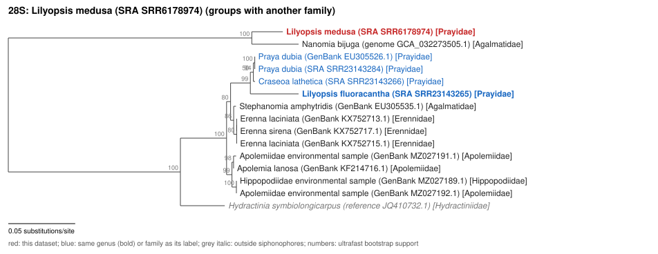

[Back to flagged datasets](#flagged-datasets)

### Study: Bergmeier et al. (2021)

Bergmeier et al. (2021). Specialized predation by deep-sea Solenogastres revealed by sequencing of gut contents. Curr Biol 31 (13), R836-R837 (2021)

- PubMed: [34256912](https://pubmed.ncbi.nlm.nih.gov/34256912/)
- Submitter: Bergmeier et al., Department Biologie II (20-APR-2021)
- Flagged datasets: [MZ027186.1](#mz0271861), [MZ027188.1](#mz0271881), [MZ027189.1](#mz0271891), [MZ027190.1](#mz0271901), [MZ027193.1](#mz0271931), [MZ027194.1](#mz0271941)

#### MZ027186.1

*Apolemiidae environmental sample* (Apolemiidae), GenBank record.

- Record: [MZ027186.1](https://www.ncbi.nlm.nih.gov/nuccore/MZ027186.1)
- Title: Apolemiidae environmental sample voucher prey of Dondersiidae sp.SB-4 ZSM Mol 20190660 large subunit ribosomal RNA gene, partial sequence
- Genes in trees: 28S

All placements of this dataset's sequences (distances are along the tree, in substitutions per site):

| Gene | Placement | Length (bp) | Aligned sites | Nearest sequence | Distance | Nearest same genus | Nearest same family | Families among nearest |
|---|---|---|---|---|---|---|---|---|
| 28S | **groups with another family** | 955 | 949 | Erennidae environmental sample (GenBank MZ027176.1) ([link](https://www.ncbi.nlm.nih.gov/nuccore/MZ027176.1)) | 0.0015 | not checked | 0.0146 | Erennidae(11) |

Closest GenBank sequences to each flagged sequence by BLAST (core_nt, 2026-11-19), excluding this record. Groups outside siphonophores are in bold:

| Sequence | Rank | Match | Organism | Group | Identity (%) | Query coverage (%) |
|---|---|---|---|---|---|---|
| 28S | 1 | [MZ027184](https://www.ncbi.nlm.nih.gov/nuccore/MZ027184) | *Erennidae environmental sample* | siphonophore | 99.6 | 100 |
| 28S | 2 | [MZ027176](https://www.ncbi.nlm.nih.gov/nuccore/MZ027176) | *Erennidae environmental sample* | siphonophore | 99.6 | 99 |
| 28S | 3 | [KX752713](https://www.ncbi.nlm.nih.gov/nuccore/KX752713) | *Erenna laciniata* | siphonophore | 99.4 | 99 |
| 28S | 4 | [KX752715](https://www.ncbi.nlm.nih.gov/nuccore/KX752715) | *Erenna laciniata* | siphonophore | 99.4 | 99 |
| 28S | 5 | [KX752714](https://www.ncbi.nlm.nih.gov/nuccore/KX752714) | *Erenna laciniata* | siphonophore | 99.4 | 99 |

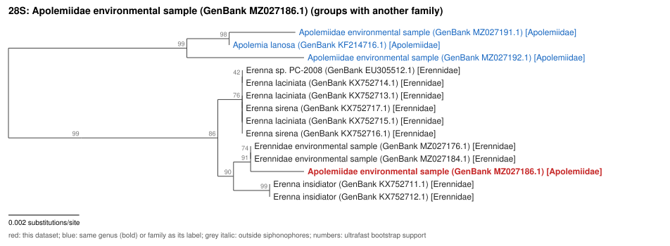

[Back to flagged datasets](#flagged-datasets)

#### MZ027188.1

*Apolemiidae environmental sample* (Apolemiidae), GenBank record.

- Record: [MZ027188.1](https://www.ncbi.nlm.nih.gov/nuccore/MZ027188.1)
- Title: Apolemiidae environmental sample voucher prey of Dondersiidae sp.SB-4 ZSM Mol 20190669 large subunit ribosomal RNA gene, partial sequence
- Genes in trees: 28S

All placements of this dataset's sequences (distances are along the tree, in substitutions per site):

| Gene | Placement | Length (bp) | Aligned sites | Nearest sequence | Distance | Nearest same genus | Nearest same family | Families among nearest |
|---|---|---|---|---|---|---|---|---|
| 28S | **groups with another family** | 962 | 960 | Erennidae environmental sample (GenBank MZ027194.1) ([link](https://www.ncbi.nlm.nih.gov/nuccore/MZ027194.1)) | 0.0005 | not checked | 0.0256 | Pyrostephidae(4),Erennidae(1) |

Closest GenBank sequences to each flagged sequence by BLAST (core_nt, 2026-11-19), excluding this record. Groups outside siphonophores are in bold:

| Sequence | Rank | Match | Organism | Group | Identity (%) | Query coverage (%) |
|---|---|---|---|---|---|---|
| 28S | 1 | [MZ027194](https://www.ncbi.nlm.nih.gov/nuccore/MZ027194) | *Erennidae environmental sample* | siphonophore | 99.9 | 95 |
| 28S | 2 | [MZ027195](https://www.ncbi.nlm.nih.gov/nuccore/MZ027195) | *Chrysopetalidae environmental sample* | **Annelida** | 99.9 | 91 |
| 28S | 3 | [QB082026](https://www.ncbi.nlm.nih.gov/nuccore/QB082026) | *Agalma elegans* | siphonophore | 94.7 | 100 |
| 28S | 4 | [QB082021](https://www.ncbi.nlm.nih.gov/nuccore/QB082021) | *Agalma elegans* | siphonophore | 94.7 | 100 |
| 28S | 5 | [MZ027184](https://www.ncbi.nlm.nih.gov/nuccore/MZ027184) | *Erennidae environmental sample* | siphonophore | 94.8 | 99 |

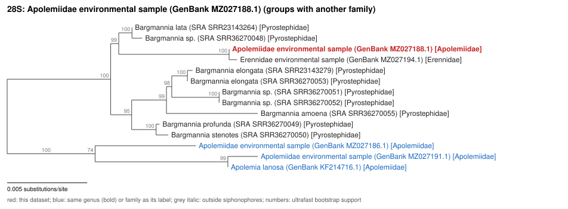

[Back to flagged datasets](#flagged-datasets)

#### MZ027189.1

*Hippopodiidae environmental sample* (Hippopodiidae), GenBank record.

- Record: [MZ027189.1](https://www.ncbi.nlm.nih.gov/nuccore/MZ027189.1)
- Title: Hippopodiidae environmental sample voucher prey of Dondersiidae sp.SB-4 ZSM Mol 20190678 large subunit ribosomal RNA gene, partial sequence
- Genes in trees: 28S

All placements of this dataset's sequences (distances are along the tree, in substitutions per site):

| Gene | Placement | Length (bp) | Aligned sites | Nearest sequence | Distance | Nearest same genus | Nearest same family | Families among nearest |
|---|---|---|---|---|---|---|---|---|
| 28S | **groups with another family** | 957 | 955 | Apolemiidae environmental sample (GenBank MZ027192.1) ([link](https://www.ncbi.nlm.nih.gov/nuccore/MZ027192.1)) | 0.0000 | not checked | 0.0324 | Apolemiidae(3),Erennidae(1),unknown(1) |

Closest GenBank sequences to each flagged sequence by BLAST (core_nt, 2026-11-19), excluding this record. Groups outside siphonophores are in bold:

| Sequence | Rank | Match | Organism | Group | Identity (%) | Query coverage (%) |
|---|---|---|---|---|---|---|
| 28S | 1 | [PV770871](https://www.ncbi.nlm.nih.gov/nuccore/PV770871) | *Siphonophorae sp.* | siphonophore | 99.6 | 100 |
| 28S | 2 | [MZ027192](https://www.ncbi.nlm.nih.gov/nuccore/MZ027192) | *Apolemiidae environmental sample* | siphonophore | 100.0 | 98 |
| 28S | 3 | [KF214716](https://www.ncbi.nlm.nih.gov/nuccore/KF214716) | *Apolemia lanosa* | siphonophore | 99.2 | 100 |
| 28S | 4 | [MZ027185](https://www.ncbi.nlm.nih.gov/nuccore/MZ027185) | *Erennidae environmental sample* | siphonophore | 99.0 | 99 |
| 28S | 5 | [KF214717](https://www.ncbi.nlm.nih.gov/nuccore/KF214717) | *Apolemia rubriversa* | siphonophore | 98.1 | 100 |

[Back to flagged datasets](#flagged-datasets)

#### MZ027190.1

*Apolemiidae environmental sample* (Apolemiidae), GenBank record.

- Record: [MZ027190.1](https://www.ncbi.nlm.nih.gov/nuccore/MZ027190.1)
- Title: Apolemiidae environmental sample voucher prey of Dondersiidae sp.SB-4 ZSM Mol 20190645 large subunit ribosomal RNA gene, partial sequence
- Genes in trees: 28S

All placements of this dataset's sequences (distances are along the tree, in substitutions per site):

| Gene | Placement | Length (bp) | Aligned sites | Nearest sequence | Distance | Nearest same genus | Nearest same family | Families among nearest |
|---|---|---|---|---|---|---|---|---|
| 28S | **groups with another family** | 959 | 957 | Chuniphyes multidentata (SRA SRR23143276) ([link](https://www.ncbi.nlm.nih.gov/sra/SRR23143276)) | 0.0004 | not checked | 0.0269 | Clausophyidae(3),Prayidae(2) |

Closest GenBank sequences to each flagged sequence by BLAST (core_nt, 2026-11-19), excluding this record. Groups outside siphonophores are in bold:

| Sequence | Rank | Match | Organism | Group | Identity (%) | Query coverage (%) |
|---|---|---|---|---|---|---|
| 28S | 1 | [EU305517](https://www.ncbi.nlm.nih.gov/nuccore/EU305517) | *Hippopodius hippopus* | siphonophore | 97.8 | 96 |
| 28S | 2 | [AY026377](https://www.ncbi.nlm.nih.gov/nuccore/AY026377) | *Nectopyramis sp. MMM-2001* | siphonophore | 96.2 | 100 |
| 28S | 3 | [MZ027184](https://www.ncbi.nlm.nih.gov/nuccore/MZ027184) | *Erennidae environmental sample* | siphonophore | 95.5 | 100 |
| 28S | 4 | [KX752708](https://www.ncbi.nlm.nih.gov/nuccore/KX752708) | *Erenna cornuta* | siphonophore | 95.6 | 99 |
| 28S | 5 | [KX752709](https://www.ncbi.nlm.nih.gov/nuccore/KX752709) | *Erenna cornuta* | siphonophore | 95.6 | 99 |

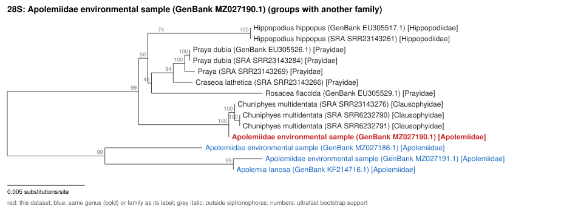

[Back to flagged datasets](#flagged-datasets)

#### MZ027193.1

*Erennidae environmental sample* (Erennidae), GenBank record.

- Record: [MZ027193.1](https://www.ncbi.nlm.nih.gov/nuccore/MZ027193.1)
- Title: Erennidae environmental sample voucher prey of Gymnomeniidae sp.SB-2 ZSM Mol 20190696 large subunit ribosomal RNA gene, partial sequence
- Genes in trees: 28S

All placements of this dataset's sequences (distances are along the tree, in substitutions per site):

| Gene | Placement | Length (bp) | Aligned sites | Nearest sequence | Distance | Nearest same genus | Nearest same family | Families among nearest |
|---|---|---|---|---|---|---|---|---|
| 28S | **groups with another family** | 177 | 176 | Lilyopsis medusa (SRA SRR6178974) ([link](https://www.ncbi.nlm.nih.gov/sra/SRR6178974)) | 0.8835 | not checked | 1.2129 | Agalmatidae(2),Apolemiidae(2),Prayidae(1),Hydractiniidae(1) |

Closest GenBank sequences to each flagged sequence by BLAST (core_nt, 2026-11-19), excluding this record. Groups outside siphonophores are in bold:

| Sequence | Rank | Match | Organism | Group | Identity (%) | Query coverage (%) |
|---|---|---|---|---|---|---|
| 28S | 1 | [DQ442599](https://www.ncbi.nlm.nih.gov/nuccore/DQ442599) | *Dysponetus bulbosus* | **Annelida** | 99.4 | 100 |
| 28S | 2 | [OP897914](https://www.ncbi.nlm.nih.gov/nuccore/OP897914) | *Eulalia sp. DBUA0002483.01.v01* | **Annelida** | 100.0 | 98 |
| 28S | 3 | [MG254467](https://www.ncbi.nlm.nih.gov/nuccore/MG254467) | *Nereiphylla rubiginosa* | **Annelida** | 100.0 | 98 |
| 28S | 4 | [LC905814](https://www.ncbi.nlm.nih.gov/nuccore/LC905814) | *Nereiphylla castanea* | **Annelida** | 100.0 | 98 |
| 28S | 5 | [MG254389](https://www.ncbi.nlm.nih.gov/nuccore/MG254389) | *Pelagobia longicirrata* | **Annelida** | 100.0 | 98 |

[Back to flagged datasets](#flagged-datasets)

#### MZ027194.1

*Erennidae environmental sample* (Erennidae), GenBank record.

- Record: [MZ027194.1](https://www.ncbi.nlm.nih.gov/nuccore/MZ027194.1)
- Title: Erennidae environmental sample voucher prey of Gymnomeniidae sp.SB-2 ZSM Mol 20190698 large subunit ribosomal RNA gene, partial sequence
- Genes in trees: 28S

All placements of this dataset's sequences (distances are along the tree, in substitutions per site):

| Gene | Placement | Length (bp) | Aligned sites | Nearest sequence | Distance | Nearest same genus | Nearest same family | Families among nearest |
|---|---|---|---|---|---|---|---|---|
| 28S | **groups with another family** | 914 | 914 | Apolemiidae environmental sample (GenBank MZ027188.1) ([link](https://www.ncbi.nlm.nih.gov/nuccore/MZ027188.1)) | 0.0005 | not checked | 0.0244 | Pyrostephidae(4),Apolemiidae(1) |

Closest GenBank sequences to each flagged sequence by BLAST (core_nt, 2026-11-19), excluding this record. Groups outside siphonophores are in bold:

| Sequence | Rank | Match | Organism | Group | Identity (%) | Query coverage (%) |
|---|---|---|---|---|---|---|
| 28S | 1 | [MZ027188](https://www.ncbi.nlm.nih.gov/nuccore/MZ027188) | *Apolemiidae environmental sample* | siphonophore | 99.9 | 100 |
| 28S | 2 | [MZ027195](https://www.ncbi.nlm.nih.gov/nuccore/MZ027195) | *Chrysopetalidae environmental sample* | **Annelida** | 99.8 | 96 |
| 28S | 3 | [KX752713](https://www.ncbi.nlm.nih.gov/nuccore/KX752713) | *Erenna laciniata* | siphonophore | 94.5 | 100 |
| 28S | 4 | [KX752715](https://www.ncbi.nlm.nih.gov/nuccore/KX752715) | *Erenna laciniata* | siphonophore | 94.5 | 100 |
| 28S | 5 | [KX752714](https://www.ncbi.nlm.nih.gov/nuccore/KX752714) | *Erenna laciniata* | siphonophore | 94.5 | 100 |

[Back to flagged datasets](#flagged-datasets)

### Study: BioProject PRJNA205486

BioProject PRJNA205486: Example analysis with automated phylogenomic tools. Transcriptome or Gene expression (submitted by Dunnlab)

- BioProject: [PRJNA205486](https://www.ncbi.nlm.nih.gov/bioproject/PRJNA205486)
- Submitter: Dunnlab (2013-06-17)
- Flagged datasets: [SRR871528](#srr871528)

#### SRR871528

*Physalia physalis* (Physaliidae), SRA run.

- Record: [SRR871528](https://www.ncbi.nlm.nih.gov/sra/SRR871528)
- ENA: [SRR871528](https://www.ebi.ac.uk/ena/browser/view/SRR871528)
- Library: RNA-Seq, transcriptomic, selection RANDOM, paired, Illumina HiSeq 2000
- Genes in trees: 28S, CO1

All placements of this dataset's sequences (distances are along the tree, in substitutions per site):

| Gene | Placement | Length (bp) | Aligned sites | Nearest sequence | Distance | Nearest same genus | Nearest same family | Families among nearest |
|---|---|---|---|---|---|---|---|---|
| 28S | consistent | 3263 | 3261 | Physalia (SRA SRR23143271) ([link](https://www.ncbi.nlm.nih.gov/sra/SRR23143271)) | 0.0006 | not checked | 0.0006 | Physaliidae(29) |
| CO1 | **groups with another family** | 691 | 641 | Lilyopsis fluoracantha (GenBank GQ120015.1) ([link](https://www.ncbi.nlm.nih.gov/nuccore/GQ120015.1)) | 0.8988 | 1.1060 | 1.1060 | Diphyidae(2),Prayidae(1),Olindiidae(1),unknown(1) |

Closest GenBank sequences to each flagged sequence by BLAST (core_nt, 2026-11-19), excluding this record. Groups outside siphonophores are in bold:

| Sequence | Rank | Match | Organism | Group | Identity (%) | Query coverage (%) |
|---|---|---|---|---|---|---|
| CO1 | 1 | [KY882128](https://www.ncbi.nlm.nih.gov/nuccore/KY882128) | *Ferosagitta robusta* | **Chaetognatha** | 86.4 | 95 |
| CO1 | 2 | [KY882126](https://www.ncbi.nlm.nih.gov/nuccore/KY882126) | *Ferosagitta robusta* | **Chaetognatha** | 86.2 | 95 |
| CO1 | 3 | [MH444759](https://www.ncbi.nlm.nih.gov/nuccore/MH444759) | *Ferosagitta robusta* | **Chaetognatha** | 86.0 | 92 |
| CO1 | 4 | [KY882127](https://www.ncbi.nlm.nih.gov/nuccore/KY882127) | *Ferosagitta robusta* | **Chaetognatha** | 84.9 | 95 |
| CO1 | 5 | [JN258035](https://www.ncbi.nlm.nih.gov/nuccore/JN258035) | *Ferosagitta robusta* | **Chaetognatha** | 85.4 | 89 |

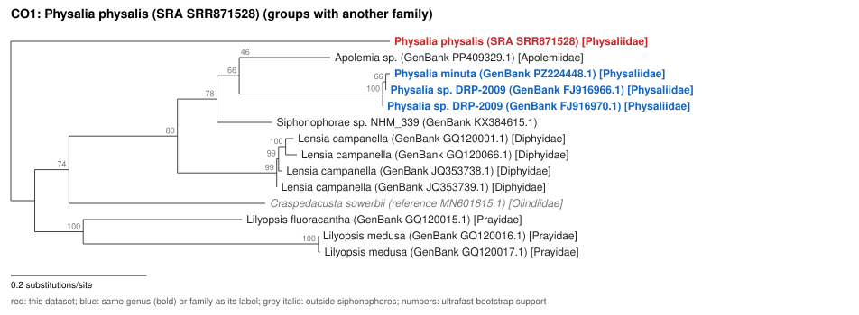

[Back to flagged datasets](#flagged-datasets)

### Study: Cartwright et al., unpublished (2007)

Cartwright et al. (unpublished, submitted 2007). Phylogenetics of Hydroidolina (Hydrozoa, Cnidaria)

- Submitter: Cartwright et al., Department of Ecology and Evolutionary Biology (28-NOV-2007)
- Flagged datasets: [EU305508.1](#eu3055081), [EU448095.1](#eu4480951)

#### EU305508.1

*Kephyes ovata* (Clausophyidae), GenBank record.

- Record: [EU305508.1](https://www.ncbi.nlm.nih.gov/nuccore/EU305508.1)
- Title: Clausophyes ovata large subunit 28S ribosomal RNA gene, partial sequence
- Genes in trees: 28S

All placements of this dataset's sequences (distances are along the tree, in substitutions per site):

| Gene | Placement | Length (bp) | Aligned sites | Nearest sequence | Distance | Nearest same genus | Nearest same family | Families among nearest |
|---|---|---|---|---|---|---|---|---|
| 28S | **groups with another family** | 3051 | 3039 | Nanomia bijuga (GenBank PV172466.1) ([link](https://www.ncbi.nlm.nih.gov/nuccore/PV172466.1)) | 0.0017 | not checked | 0.0398 | Agalmatidae(11) |

Closest GenBank sequences to each flagged sequence by BLAST (core_nt, 2026-11-19), excluding this record. Groups outside siphonophores are in bold:

| Sequence | Rank | Match | Organism | Group | Identity (%) | Query coverage (%) |
|---|---|---|---|---|---|---|
| 28S | 1 | [EU448095](https://www.ncbi.nlm.nih.gov/nuccore/EU448095) | *Physalia physalis* | siphonophore | 95.8 | 99 |
| 28S | 2 | [EU272576](https://www.ncbi.nlm.nih.gov/nuccore/EU272576) | *Nanomia bijuga* | siphonophore | 99.2 | 85 |
| 28S | 3 | [EU272566](https://www.ncbi.nlm.nih.gov/nuccore/EU272566) | *Halistemma rubrum* | siphonophore | 98.7 | 85 |
| 28S | 4 | [QB082026](https://www.ncbi.nlm.nih.gov/nuccore/QB082026) | *Agalma elegans* | siphonophore | 98.6 | 85 |
| 28S | 5 | [QB082021](https://www.ncbi.nlm.nih.gov/nuccore/QB082021) | *Agalma elegans* | siphonophore | 98.6 | 85 |

[Back to flagged datasets](#flagged-datasets)

#### EU448095.1

*Physalia physalis* (Physaliidae), GenBank record.

- Record: [EU448095.1](https://www.ncbi.nlm.nih.gov/nuccore/EU448095.1)
- Title: Physalia physalis 28S large subunit ribosomal RNA gene, partial sequence
- Genes in trees: 28S

All placements of this dataset's sequences (distances are along the tree, in substitutions per site):

| Gene | Placement | Length (bp) | Aligned sites | Nearest sequence | Distance | Nearest same genus | Nearest same family | Families among nearest |
|---|---|---|---|---|---|---|---|---|
| 28S | **groups with another family** | 3093 | 3078 | Sulculeolaria quadrivalvis (GenBank EU272594.1) ([link](https://www.ncbi.nlm.nih.gov/nuccore/EU272594.1)) | 0.0047 | not checked | 0.1254 | Diphyidae(5),Abylidae(2) |

Closest GenBank sequences to each flagged sequence by BLAST (core_nt, 2026-11-19), excluding this record. Groups outside siphonophores are in bold:

| Sequence | Rank | Match | Organism | Group | Identity (%) | Query coverage (%) |
|---|---|---|---|---|---|---|
| 28S | 1 | [EU305508](https://www.ncbi.nlm.nih.gov/nuccore/EU305508) | *Kephyes ovata* | siphonophore | 95.8 | 97 |
| 28S | 2 | [EU272594](https://www.ncbi.nlm.nih.gov/nuccore/EU272594) | *Sulculeolaria quadrivalvis* | siphonophore | 98.9 | 84 |
| 28S | 3 | [EU272576](https://www.ncbi.nlm.nih.gov/nuccore/EU272576) | *Nanomia bijuga* | siphonophore | 97.9 | 84 |
| 28S | 4 | [EU272566](https://www.ncbi.nlm.nih.gov/nuccore/EU272566) | *Halistemma rubrum* | siphonophore | 97.8 | 84 |
| 28S | 5 | [AY026377](https://www.ncbi.nlm.nih.gov/nuccore/AY026377) | *Nectopyramis sp. MMM-2001* | siphonophore | 97.8 | 84 |

[Back to flagged datasets](#flagged-datasets)

### Study: Dunn et al. (2005)

Dunn et al. (2005). Molecular phylogenetics of the siphonophora (Cnidaria), with implications for the evolution of functional specialization. Syst. Biol. 54 (6), 916-935 (2005)

- PubMed: [16338764](https://pubmed.ncbi.nlm.nih.gov/16338764/)
- Submitter: Dunn et al., Department of Ecology and Evolutionary Biology (15-FEB-2005)
- Flagged datasets: [AY935305.1](#ay9353051)

#### AY935305.1

*Clausophyid sp. 1 CWD-2005* (Clausophyidae), GenBank record.

- Record: [AY935305.1](https://www.ncbi.nlm.nih.gov/nuccore/AY935305.1)
- Title: Clausophyid sp. 1 CWD-2005 16S ribosomal RNA gene, partial sequence; mitochondrial
- Genes in trees: 16S

All placements of this dataset's sequences (distances are along the tree, in substitutions per site):

| Gene | Placement | Length (bp) | Aligned sites | Nearest sequence | Distance | Nearest same genus | Nearest same family | Families among nearest |
|---|---|---|---|---|---|---|---|---|
| 16S | **groups with another family** | 588 | 472 | Calycophorae sp. LC-2017 (GenBank KX374465.1) ([link](https://www.ncbi.nlm.nih.gov/nuccore/KX374465.1)) | 0.0329 | none in tree | 0.3783 | Apolemiidae(4),Agalmatidae(2),unknown(1) |

Closest GenBank sequences to each flagged sequence by BLAST (core_nt, 2026-11-19), excluding this record. Groups outside siphonophores are in bold:

| Sequence | Rank | Match | Organism | Group | Identity (%) | Query coverage (%) |
|---|---|---|---|---|---|---|
| 16S | 1 | [KX374465](https://www.ncbi.nlm.nih.gov/nuccore/KX374465) | *Calycophorae sp. LC-2017* | siphonophore | 95.2 | 87 |
| 16S | 2 | [AY935289](https://www.ncbi.nlm.nih.gov/nuccore/AY935289) | *Apolemia sp. 2 CWD-2005* | siphonophore | 82.2 | 99 |
| 16S | 3 | [OQ957201](https://www.ncbi.nlm.nih.gov/nuccore/OQ957201) | *Apolemia sp. 3 CWD-2005* | siphonophore | 82.0 | 99 |
| 16S | 4 | [AY935290](https://www.ncbi.nlm.nih.gov/nuccore/AY935290) | *Apolemia sp. 3 CWD-2005* | siphonophore | 82.0 | 99 |
| 16S | 5 | [PP356926](https://www.ncbi.nlm.nih.gov/nuccore/PP356926) | *Apolemia sp.* | siphonophore | 81.9 | 99 |

[Back to flagged datasets](#flagged-datasets)

### Study: Park et al. (2021)

Park et al. (2021). Novel attempt at discrimination of a bullet-shaped siphonophore (Family Diphyidae) using matrix-assisted laser desorption/ionization time of flight mass spectrometry (MALDI-ToF MS). Sci Rep 11 (1), 19077 (2021)

- PubMed: [34561535](https://pubmed.ncbi.nlm.nih.gov/34561535/)
- Submitter: Park, Department of Life Science (18-MAY-2021)
- Flagged datasets: [MZ230467.1](#mz2304671)

#### MZ230467.1

*Dimophyes arctica* (Diphyidae), GenBank record.

- Record: [MZ230467.1](https://www.ncbi.nlm.nih.gov/nuccore/MZ230467.1)
- Title: Dimophyes arctica isolate DA1 large subunit ribosomal RNA gene, partial sequence; mitochondrial
- Genes in trees: 16S

All placements of this dataset's sequences (distances are along the tree, in substitutions per site):

| Gene | Placement | Length (bp) | Aligned sites | Nearest sequence | Distance | Nearest same genus | Nearest same family | Families among nearest |
|---|---|---|---|---|---|---|---|---|
| 16S | **groups with another family** | 540 | 430 | Agalma elegans (GenBank NC_080954.1) ([link](https://www.ncbi.nlm.nih.gov/nuccore/NC_080954.1)) | 0.0000 | none in tree | 0.5925 | Agalmatidae(15) |

Closest GenBank sequences to each flagged sequence by BLAST (core_nt, 2026-11-19), excluding this record. Groups outside siphonophores are in bold:

| Sequence | Rank | Match | Organism | Group | Identity (%) | Query coverage (%) |
|---|---|---|---|---|---|---|
| 16S | 1 | [OQ957203](https://www.ncbi.nlm.nih.gov/nuccore/OQ957203) | *Agalma elegans* | siphonophore | 100.0 | 100 |
| 16S | 2 | [NC_080954](https://www.ncbi.nlm.nih.gov/nuccore/NC_080954) | *Agalma elegans* | siphonophore | 100.0 | 100 |
| 16S | 3 | [QB051279](https://www.ncbi.nlm.nih.gov/nuccore/QB051279) | *Agalma elegans* | siphonophore | 99.8 | 100 |
| 16S | 4 | [QB051274](https://www.ncbi.nlm.nih.gov/nuccore/QB051274) | *Agalma elegans* | siphonophore | 99.8 | 100 |
| 16S | 5 | [AY935271](https://www.ncbi.nlm.nih.gov/nuccore/AY935271) | *Agalma elegans* | siphonophore | 100.0 | 96 |

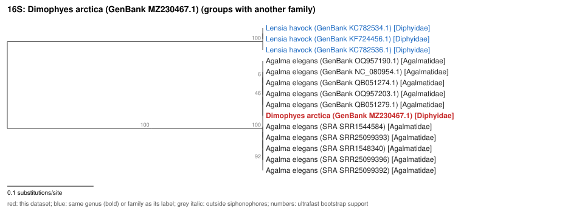

[Back to flagged datasets](#flagged-datasets)

### Study: Questel et al., unpublished (2024)

Questel et al. (unpublished, submitted 2024). DNA barcoding deep-water zooplankton from the Gulf of Alaska, North Pacific Ocean

- BioProject: [PRJNA1077907](https://www.ncbi.nlm.nih.gov/bioproject/PRJNA1077907)
- Submitter: Collins et al., Invertebrate Zoology (19-FEB-2024)
- Flagged datasets: [PP356949.1](#pp3569491), [PP409275.1](#pp4092751)

#### PP356949.1

*Rudjakovia sp.* (Agalmatidae), GenBank record.

- Record: [PP356949.1](https://www.ncbi.nlm.nih.gov/nuccore/PP356949.1)
- Title: Rudjakovia sp. isolate SQ19_16S_825E.1 large subunit ribosomal RNA gene, partial sequence; mitochondrial
- Genes in trees: 16S

All placements of this dataset's sequences (distances are along the tree, in substitutions per site):

| Gene | Placement | Length (bp) | Aligned sites | Nearest sequence | Distance | Nearest same genus | Nearest same family | Families among nearest |
|---|---|---|---|---|---|---|---|---|
| 16S | **groups with another family** | 582 | 479 | Erenna insidiator (GenBank KX752719.1) ([link](https://www.ncbi.nlm.nih.gov/nuccore/KX752719.1)) | 0.0913 | none in tree | 0.1406 | Erennidae(8) |

Closest GenBank sequences to each flagged sequence by BLAST (core_nt, 2026-11-19), excluding this record. Groups outside siphonophores are in bold:

| Sequence | Rank | Match | Organism | Group | Identity (%) | Query coverage (%) |
|---|---|---|---|---|---|---|
| 16S | 1 | [AY935319](https://www.ncbi.nlm.nih.gov/nuccore/AY935319) | *Erenna sp. CWD-2005* | siphonophore | 90.4 | 100 |
| 16S | 2 | [NC_080945](https://www.ncbi.nlm.nih.gov/nuccore/NC_080945) | *Erenna sirena* | siphonophore | 90.4 | 100 |
| 16S | 3 | [NC_080956](https://www.ncbi.nlm.nih.gov/nuccore/NC_080956) | *Stephanomia amphytridis* | siphonophore | 89.1 | 100 |
| 16S | 4 | [AY935280](https://www.ncbi.nlm.nih.gov/nuccore/AY935280) | *Stephanomia amphytridis* | siphonophore | 89.1 | 100 |
| 16S | 5 | [KU716072](https://www.ncbi.nlm.nih.gov/nuccore/KU716072) | *Dendrogramma enigmatica* | siphonophore | 88.5 | 100 |

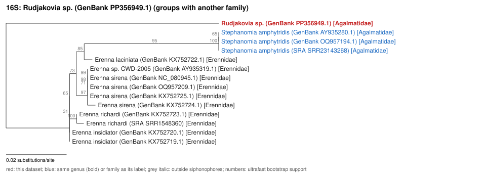

[Back to flagged datasets](#flagged-datasets)

#### PP409275.1

*Lensia asymmetrica* (Diphyidae), GenBank record.

- Record: [PP409275.1](https://www.ncbi.nlm.nih.gov/nuccore/PP409275.1)
- Title: Lensia asymmetrica isolate SQ19_16S_101E cytochrome c oxidase subunit I (COX1) gene, partial cds; mitochondrial
- Genes in trees: CO1

All placements of this dataset's sequences (distances are along the tree, in substitutions per site):

| Gene | Placement | Length (bp) | Aligned sites | Nearest sequence | Distance | Nearest same genus | Nearest same family | Families among nearest |
|---|---|---|---|---|---|---|---|---|
| CO1 | **groups with another family** | 516 | 477 | Praya sp. (GenBank OQ957213.1) ([link](https://www.ncbi.nlm.nih.gov/nuccore/OQ957213.1)) | 1.1766 | 1.3105 | 1.2063 | Prayidae(6) |

Closest GenBank sequences to each flagged sequence by BLAST (core_nt, 2026-11-19), excluding this record. Groups outside siphonophores are in bold:

| Sequence | Rank | Match | Organism | Group | Identity (%) | Query coverage (%) |
|---|---|---|---|---|---|---|
| CO1 |  | no significant match |  |  |  |  |

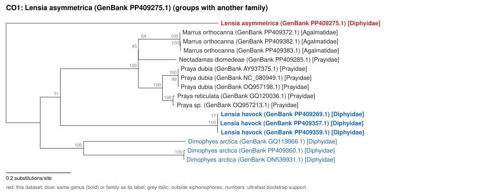

[Back to flagged datasets](#flagged-datasets)

### Study: Submitted by Manko et al., Laboratoire de Biologie du Developpement de Villefranche-sur-mer

Submitted by Manko et al., Laboratoire de Biologie du Developpement de Villefranche-sur-mer

- Submitter: Manko et al., Laboratoire de Biologie du Developpement de Villefranche-sur-mer (19-FEB-2025)
- Flagged datasets: [PV190284.1](#pv1902841)

#### PV190284.1

*Maresearsia praeclara* (Prayidae), GenBank record.

- Record: [PV190284.1](https://www.ncbi.nlm.nih.gov/nuccore/PV190284.1)
- Title: Maresearsia praeclara voucher personal collection:MKM:B82:Photo voucher large subunit ribosomal RNA gene, partial sequence; mitochondrial
- Genes in trees: 16S

All placements of this dataset's sequences (distances are along the tree, in substitutions per site):

| Gene | Placement | Length (bp) | Aligned sites | Nearest sequence | Distance | Nearest same genus | Nearest same family | Families among nearest |
|---|---|---|---|---|---|---|---|---|
| 16S | **groups with another family** | 581 | 471 | Apolemia sp. (GenBank PP356925.1) ([link](https://www.ncbi.nlm.nih.gov/nuccore/PP356925.1)) | 0.1019 | none in tree | 0.1801 | Apolemiidae(5) |

Closest GenBank sequences to each flagged sequence by BLAST (core_nt, 2026-11-19), excluding this record. Groups outside siphonophores are in bold:

| Sequence | Rank | Match | Organism | Group | Identity (%) | Query coverage (%) |
|---|---|---|---|---|---|---|
| 16S | 1 | [OQ957213](https://www.ncbi.nlm.nih.gov/nuccore/OQ957213) | *Praya sp.* | siphonophore | 86.7 | 92 |
| 16S | 2 | [AY935285](https://www.ncbi.nlm.nih.gov/nuccore/AY935285) | *Praya dubia* | siphonophore | 87.5 | 86 |
| 16S | 3 | [NC_080949](https://www.ncbi.nlm.nih.gov/nuccore/NC_080949) | *Praya dubia* | siphonophore | 87.5 | 86 |
| 16S | 4 | [DQ080009](https://www.ncbi.nlm.nih.gov/nuccore/DQ080009) | *Lychnagalma utricularia* | siphonophore | 86.5 | 91 |
| 16S | 5 | [MK958598](https://www.ncbi.nlm.nih.gov/nuccore/MK958598) | *Frillagalma vityazi* | siphonophore | 87.0 | 86 |

[Back to flagged datasets](#flagged-datasets)

### Study: Submitted by William, Genoscope CEA

Submitted by William, Genoscope CEA

- BioProject: [PRJEB123269](https://www.ncbi.nlm.nih.gov/bioproject/PRJEB123269)
- Submitter: William, Genoscope CEA (06-AUG-2026)
- Flagged datasets: [OZ505748.1](#oz5057481)

#### OZ505748.1

*Halistemma rubrum* (Agalmatidae), GenBank record.

- Record: [OZ505748.1](https://www.ncbi.nlm.nih.gov/nuccore/OZ505748.1)
- Title: Halistemma rubrum genome assembly, organelle: mitochondrion
- Genes in trees: 16S, CO1

All placements of this dataset's sequences (distances are along the tree, in substitutions per site):

| Gene | Placement | Length (bp) | Aligned sites | Nearest sequence | Distance | Nearest same genus | Nearest same family | Families among nearest |
|---|---|---|---|---|---|---|---|---|
| 16S | consistent | 703 | 444 | Halistemma rubrum (genome GCA_987347065.1) ([link](https://www.ncbi.nlm.nih.gov/datasets/genome/GCA_987347065.1/)) | 0.0000 | 0.0000 | 0.0000 | Apolemiidae(4),Agalmatidae(1),Prayidae(1) |
| CO1 | **groups with another family** | 597 | 514 | Forskalia tholoides (GenBank AY937370.1) ([link](https://www.ncbi.nlm.nih.gov/nuccore/AY937370.1)) | 10.0224 | 10.4326 | 10.3933 | Forskaliidae(5) |
| CO1 | consistent | 771 | 717 | Halistemma rubrum (GenBank AY937372.1) ([link](https://www.ncbi.nlm.nih.gov/nuccore/AY937372.1)) | 0.0000 | 0.0000 | 0.0000 | Agalmatidae(5) |

Another copy of the same gene from this dataset placed as expected. A foreign copy alongside a consistent one points to contamination in the sequenced material, not to a misidentified specimen.

Closest GenBank sequences to each flagged sequence by BLAST (core_nt, 2026-11-19), excluding this record. Groups outside siphonophores are in bold:

| Sequence | Rank | Match | Organism | Group | Identity (%) | Query coverage (%) |
|---|---|---|---|---|---|---|
| CO1 | 1 | [NC_080957](https://www.ncbi.nlm.nih.gov/nuccore/NC_080957) | *Halistemma rubrum* | siphonophore | 100.0 | 100 |
| CO1 | 2 | [OQ957197](https://www.ncbi.nlm.nih.gov/nuccore/OQ957197) | *Halistemma rubrum* | siphonophore | 96.5 | 100 |
| CO1 | 3 | [OQ957203](https://www.ncbi.nlm.nih.gov/nuccore/OQ957203) | *Agalma elegans* | siphonophore | 88.3 | 98 |
| CO1 | 4 | [NC_080953](https://www.ncbi.nlm.nih.gov/nuccore/NC_080953) | *Agalma clausi* | siphonophore | 88.2 | 99 |
| CO1 | 5 | [NC_080954](https://www.ncbi.nlm.nih.gov/nuccore/NC_080954) | *Agalma elegans* | siphonophore | 87.9 | 98 |

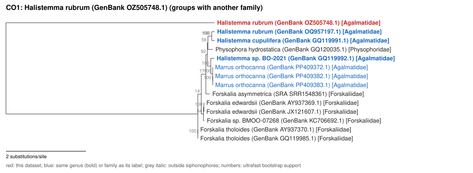

[Back to flagged datasets](#flagged-datasets)

### Study: He et al., unpublished (2013)

He et al. (unpublished, submitted 2013). DNA barcoding Medusozoa of China Seas

- Submitter: He et al., Department of Marine Biological Science and Technology (11-DEC-2013)
- Flagged datasets: [KF962059.1](#kf9620591), [KF962394.1](#kf9623941)

#### KF962059.1

*Agalma elegans* (Agalmatidae), GenBank record.

- Record: [KF962059.1](https://www.ncbi.nlm.nih.gov/nuccore/KF962059.1)
- Title: Agalma elegans voucher XMAE1 cytochrome oxidase subunit I (COI) gene, partial cds; mitochondrial
- Genes in trees: CO1

All placements of this dataset's sequences (distances are along the tree, in substitutions per site):

| Gene | Placement | Length (bp) | Aligned sites | Nearest sequence | Distance | Nearest same genus | Nearest same family | Families among nearest |
|---|---|---|---|---|---|---|---|---|
| CO1 | **groups with another genus** | 617 | 570 | Nanomia bijuga (GenBank KF977305.1) ([link](https://www.ncbi.nlm.nih.gov/nuccore/KF977305.1)) | 0.0000 | 0.2434 | 0.0000 | Agalmatidae(5) |

Closest GenBank sequences to each flagged sequence by BLAST (core_nt, 2026-11-19), excluding this record. Groups outside siphonophores are in bold:

| Sequence | Rank | Match | Organism | Group | Identity (%) | Query coverage (%) |
|---|---|---|---|---|---|---|
| CO1 | 1 | [KF977305](https://www.ncbi.nlm.nih.gov/nuccore/KF977305) | *Nanomia bijuga* | siphonophore | 100.0 | 100 |
| CO1 | 2 | [JQ716068](https://www.ncbi.nlm.nih.gov/nuccore/JQ716068) | *Nanomia bijuga* | siphonophore | 100.0 | 90 |
| CO1 | 3 | [KC732431](https://www.ncbi.nlm.nih.gov/nuccore/KC732431) | *zooplankton environmental sample* | **unclassified** | 100.0 | 75 |
| CO1 | 4 | [KC732432](https://www.ncbi.nlm.nih.gov/nuccore/KC732432) | *zooplankton environmental sample* | **unclassified** | 99.8 | 75 |
| CO1 | 5 | [GQ119991](https://www.ncbi.nlm.nih.gov/nuccore/GQ119991) | *Halistemma cupulifera* | siphonophore | 86.4 | 98 |

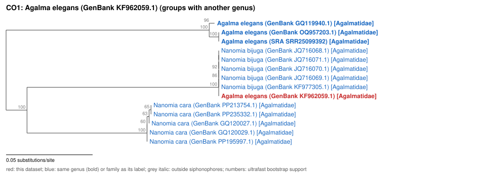

[Back to flagged datasets](#flagged-datasets)

#### KF962394.1

*Agalma elegans* (Agalmatidae), GenBank record.

- Record: [KF962394.1](https://www.ncbi.nlm.nih.gov/nuccore/KF962394.1)
- Title: Agalma elegans voucher XMAE1 16S ribosomal RNA gene, partial sequence; mitochondrial
- Genes in trees: 16S

All placements of this dataset's sequences (distances are along the tree, in substitutions per site):

| Gene | Placement | Length (bp) | Aligned sites | Nearest sequence | Distance | Nearest same genus | Nearest same family | Families among nearest |
|---|---|---|---|---|---|---|---|---|
| 16S | **groups with another genus** | 481 | 380 | Nanomia bijuga (GenBank KF977401.1) ([link](https://www.ncbi.nlm.nih.gov/nuccore/KF977401.1)) | 0.0000 | 0.1275 | 0.0000 | Agalmatidae(16) |

Closest GenBank sequences to each flagged sequence by BLAST (core_nt, 2026-11-19), excluding this record. Groups outside siphonophores are in bold:

| Sequence | Rank | Match | Organism | Group | Identity (%) | Query coverage (%) |
|---|---|---|---|---|---|---|
| 16S | 1 | [KF977379](https://www.ncbi.nlm.nih.gov/nuccore/KF977379) | *Euchaeta concinna* | **Arthropoda** | 99.8 | 100 |
| 16S | 2 | [KF977401](https://www.ncbi.nlm.nih.gov/nuccore/KF977401) | *Nanomia bijuga* | siphonophore | 99.8 | 100 |
| 16S | 3 | [OQ957219](https://www.ncbi.nlm.nih.gov/nuccore/OQ957219) | *Nanomia sp.* | siphonophore | 91.5 | 100 |
| 16S | 4 | [LN901207](https://www.ncbi.nlm.nih.gov/nuccore/LN901207) | *Nanomia bijuga* | siphonophore | 91.3 | 100 |
| 16S | 5 | [PP231859](https://www.ncbi.nlm.nih.gov/nuccore/PP231859) | *Nanomia septata* | siphonophore | 91.7 | 97 |

[Back to flagged datasets](#flagged-datasets)

### Study: Licandro et al., unpublished (2014)

Licandro et al. (unpublished, submitted 2014). Biogeography of jellyfish in the North Atlantic, by traditional and genomic methods

- Submitter: Kirby, Mrine Institute (20-MAY-2014)
- Flagged datasets: [KJ866199.1](#kj8661991)

#### KJ866199.1

*Muggiaea bargmannae* (Diphyidae), GenBank record.

- Record: [KJ866199.1](https://www.ncbi.nlm.nih.gov/nuccore/KJ866199.1)
- Title: Muggiaea bargmannae isolate G36 16S ribosomal RNA gene, partial sequence; mitochondrial
- Genes in trees: 16S

All placements of this dataset's sequences (distances are along the tree, in substitutions per site):

| Gene | Placement | Length (bp) | Aligned sites | Nearest sequence | Distance | Nearest same genus | Nearest same family | Families among nearest |
|---|---|---|---|---|---|---|---|---|
| 16S | **groups with another genus** | 147 | 133 | Lensia hostile (GenBank KC782551.1) ([link](https://www.ncbi.nlm.nih.gov/nuccore/KC782551.1)) | 0.2340 | 0.6712 | 0.2340 | Diphyidae(6) |

Closest GenBank sequences to each flagged sequence by BLAST (core_nt, 2026-11-19), excluding this record. Groups outside siphonophores are in bold:

| Sequence | Rank | Match | Organism | Group | Identity (%) | Query coverage (%) |
|---|---|---|---|---|---|---|
| 16S | 1 | [KC782551](https://www.ncbi.nlm.nih.gov/nuccore/KC782551) | *Lensia hostile* | siphonophore | 85.7 | 100 |
| 16S | 2 | [KC782552](https://www.ncbi.nlm.nih.gov/nuccore/KC782552) | *Lensia hostile* | siphonophore | 85.7 | 100 |
| 16S | 3 | [PV190273](https://www.ncbi.nlm.nih.gov/nuccore/PV190273) | *Bassia bassensis* | siphonophore | 79.7 | 100 |

[Back to flagged datasets](#flagged-datasets)

### Study: Nawrocki et al. (2013)

Nawrocki et al. (2013). Phylogenetic placement of Hydra and relationships within Aplanulata (Cnidaria: Hydrozoa). Mol. Phylogenet. Evol. 67 (1), 60-71 (2013)

- PubMed: [23280366](https://pubmed.ncbi.nlm.nih.gov/23280366/)
- Submitter: Nawrocki et al., Ecology and Evolutionary Biology (31-MAY-2012)
- Flagged datasets: [JX121606.1](#jx1216061)

#### JX121606.1

*Kephyes ovata* (Clausophyidae), GenBank record.

- Record: [JX121606.1](https://www.ncbi.nlm.nih.gov/nuccore/JX121606.1)
- Title: Clausophyes ovata voucher YPM:35349 cytochrome oxidase subunit I (COI) gene, partial cds; mitochondrial
- Genes in trees: CO1

All placements of this dataset's sequences (distances are along the tree, in substitutions per site):

| Gene | Placement | Length (bp) | Aligned sites | Nearest sequence | Distance | Nearest same genus | Nearest same family | Families among nearest |
|---|---|---|---|---|---|---|---|---|
| CO1 | **groups with another genus** | 508 | 469 | Chuniphyes multidentata (GenBank GQ119964.1) ([link](https://www.ncbi.nlm.nih.gov/nuccore/GQ119964.1)) | 0.0022 | 0.7359 | 0.0022 | Clausophyidae(6) |

Closest GenBank sequences to each flagged sequence by BLAST (core_nt, 2026-11-19), excluding this record. Groups outside siphonophores are in bold:

| Sequence | Rank | Match | Organism | Group | Identity (%) | Query coverage (%) |
|---|---|---|---|---|---|---|
| CO1 | 1 | [PP409318](https://www.ncbi.nlm.nih.gov/nuccore/PP409318) | *Chuniphyes multidentata* | siphonophore | 99.8 | 100 |
| CO1 | 2 | [GQ119964](https://www.ncbi.nlm.nih.gov/nuccore/GQ119964) | *Chuniphyes multidentata* | siphonophore | 99.8 | 100 |
| CO1 | 3 | [NC_080940](https://www.ncbi.nlm.nih.gov/nuccore/NC_080940) | *Chuniphyes multidentata* | siphonophore | 99.6 | 100 |
| CO1 | 4 | [PP409302](https://www.ncbi.nlm.nih.gov/nuccore/PP409302) | *Chuniphyes multidentata* | siphonophore | 99.6 | 100 |
| CO1 | 5 | [PP409278](https://www.ncbi.nlm.nih.gov/nuccore/PP409278) | *Chuniphyes multidentata* | siphonophore | 99.6 | 100 |

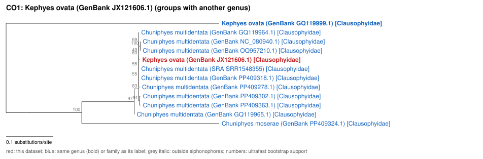

[Back to flagged datasets](#flagged-datasets)

### Study: Ortman et al. (2010)

Ortman et al. (2010). DNA Barcoding the Medusozoa using mtCOI. Deep Sea Res. Part II Top. Stud. Oceanogr. 57 (24-26), 2148-2156 (2010)

- Submitter: Ortman et al., Marine Sciences (06-MAY-2009)
- Flagged datasets: [GQ119992.1](#gq1199921), [GQ120022.1](#gq1200221)

#### GQ119992.1

*Halistemma sp. BO-2021* (Agalmatidae), GenBank record.

- Record: [GQ119992.1](https://www.ncbi.nlm.nih.gov/nuccore/GQ119992.1)
- Title: Halistemma sp. BO-2021 voucher Hy048.8.1 cytochrome oxidase subunit I (COI) gene, partial cds; mitochondrial
- Genes in trees: CO1

All placements of this dataset's sequences (distances are along the tree, in substitutions per site):

| Gene | Placement | Length (bp) | Aligned sites | Nearest sequence | Distance | Nearest same genus | Nearest same family | Families among nearest |
|---|---|---|---|---|---|---|---|---|
| CO1 | **groups with another genus** | 1017 | 952 | Physonectae sp. 1 BO-2009 (GenBank GQ119990.1) ([link](https://www.ncbi.nlm.nih.gov/nuccore/GQ119990.1)) | 0.0012 | 0.3546 | 0.0030 | Agalmatidae(5),unknown(1) |

Closest GenBank sequences to each flagged sequence by BLAST (core_nt, 2026-11-19), excluding this record. Groups outside siphonophores are in bold:

| Sequence | Rank | Match | Organism | Group | Identity (%) | Query coverage (%) |
|---|---|---|---|---|---|---|
| CO1 | 1 | [NC_080956](https://www.ncbi.nlm.nih.gov/nuccore/NC_080956) | *Stephanomia amphytridis* | siphonophore | 99.7 | 100 |
| CO1 | 2 | [GQ119990](https://www.ncbi.nlm.nih.gov/nuccore/GQ119990) | *Physonectae sp. 1 BO-2009* | siphonophore | 99.8 | 95 |
| CO1 | 3 | [NC_080945](https://www.ncbi.nlm.nih.gov/nuccore/NC_080945) | *Erenna sirena* | siphonophore | 89.6 | 100 |
| CO1 | 4 | [GQ120020](https://www.ncbi.nlm.nih.gov/nuccore/GQ120020) | *Marrus sp. BO-2021* | siphonophore | 89.2 | 100 |
| CO1 | 5 | [OQ957211](https://www.ncbi.nlm.nih.gov/nuccore/OQ957211) | *Physonectae sp.* | siphonophore | 88.5 | 100 |

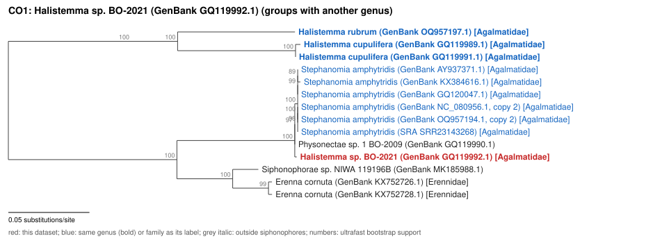

[Back to flagged datasets](#flagged-datasets)

#### GQ120022.1

*Halistemma sp. BO-2021* (Agalmatidae), GenBank record.

- Record: [GQ120022.1](https://www.ncbi.nlm.nih.gov/nuccore/GQ120022.1)
- Title: Halistemma sp. BO-2021 voucher Hy048.2. cytochrome oxidase subunit I (COI) gene, partial cds; mitochondrial
- Genes in trees: CO1

All placements of this dataset's sequences (distances are along the tree, in substitutions per site):

| Gene | Placement | Length (bp) | Aligned sites | Nearest sequence | Distance | Nearest same genus | Nearest same family | Families among nearest |
|---|---|---|---|---|---|---|---|---|
| CO1 | **groups with another genus** | 996 | 934 | Nanomia bijuga (GenBank AY937373.1) ([link](https://www.ncbi.nlm.nih.gov/nuccore/AY937373.1)) | 0.0034 | 0.3380 | 0.0034 | Agalmatidae(6) |

Closest GenBank sequences to each flagged sequence by BLAST (core_nt, 2026-11-19), excluding this record. Groups outside siphonophores are in bold:

| Sequence | Rank | Match | Organism | Group | Identity (%) | Query coverage (%) |
|---|---|---|---|---|---|---|
| CO1 | 1 | [NC_080958](https://www.ncbi.nlm.nih.gov/nuccore/NC_080958) | *Nanomia bijuga* | siphonophore | 99.7 | 100 |
| CO1 | 2 | [ON532083](https://www.ncbi.nlm.nih.gov/nuccore/ON532083) | *Nanomia bijuga* | siphonophore | 96.8 | 81 |
| CO1 | 3 | [PP235329](https://www.ncbi.nlm.nih.gov/nuccore/PP235329) | *Nanomia bijuga* | siphonophore | 96.8 | 80 |
| CO1 | 4 | [PP235330](https://www.ncbi.nlm.nih.gov/nuccore/PP235330) | *Nanomia bijuga* | siphonophore | 96.8 | 80 |
| CO1 | 5 | [PP235331](https://www.ncbi.nlm.nih.gov/nuccore/PP235331) | *Nanomia bijuga* | siphonophore | 96.6 | 80 |

[Back to flagged datasets](#flagged-datasets)

## How to read a flag

Each sequence is compared with its nearest sequences in the gene tree, measured as distance along the branches. Sequences from the same dataset (for example two copies from one genome) are ignored as neighbours. The outcomes are:

| Outcome | Meaning |
|---|---|
| Groups outside siphonophores | Most nearest sequences are not siphonophores, or the nearest one is not and every siphonophore sequence is clearly farther. Typical of contamination (prey, symbionts, other samples) or a non-siphonophore labelled as one. |
| Groups with another family | Sequences of the labelled family are in the tree, none is among the nearest, and the nearest of them is clearly farther than the nearest sequence. |
| Groups with another genus | As above for the labelled genus. Checked only for 16S and CO1. |
| Unresolved | The labelled genus or family is not among the nearest, but is about as close (within the distance margin below). The gene cannot tell them apart here. |
| Consistent | The labelled genus and family are among the nearest sequences. |
| Not evaluable | The label has no genus or family, or it is the only dataset of its genus or family in the tree. |
| Not in tree | The sequence was too short, or kept too few aligned sites after trimming. |

Points to keep in mind:

- **18S and 28S evolve slowly in siphonophores** and often do not differ between genera, so they are checked at family level only. 16S and CO1 are checked at genus and family level.
- **A single flag can have causes other than misidentification**: a genus or family that is not monophyletic, sparse sampling of a group, a short or partial sequence (see *Aligned sites*), or an error in the comparison sequence instead. When two sequences are each other's nearest neighbours and disagree, the tree alone cannot say which is wrong.
- **Agreement across genes and data types is the strongest evidence.** A dataset flagged in several genes, or whose flagged sequence matches an independent dataset of another species, is more likely to be misidentified or contaminated.
- **Genome assemblies can contain DNA of other organisms.** Up to 3 copies of a gene are taken from each assembly. When one copy is foreign and another is consistent, the assembly probably includes contaminating sequence, but its species label is likely correct.
- **A long distance to the nearest sequence** (more than a few tenths of a substitution per site) means the sequence resembles nothing else in the tree. It may not be a siphonophore sequence at all, may not be the gene it was identified as, or may be poor quality. The BLAST matches in each dataset's section show what it most resembles in GenBank.
- **The trees contain only siphonophores and a few other hydrozoans.** A sequence from a more distant organism (for example a sea anemone, a copepod or an annelid) still has to be placed somewhere, usually among the siphonophores, so it is often flagged as belonging to another family rather than as outside siphonophores. Its BLAST matches show what it really is.
- **Environmental sequences** carry the taxonomy their submitters assigned, which may itself be an inference.
- **Species names** are those of the NCBI Taxonomy entry the data are attached to, and genus and family come from the NCBI lineage.

## Methods

- **Inventory.** NCBI Nucleotide, ENA (raw reads) and NCBI Datasets (genome assemblies) were queried for everything below NCBI Taxonomy ID 42759 (Siphonophorae) on 2026-11-18. Nucleotide records that are pieces of genome assemblies, or shotgun project master records, are listed but not analysed separately, because their assemblies and reads are analysed directly.
- **Gene identification.** Each GenBank record, genome assembly and read-derived sequence was compared with reference marker sequences using BLAST (`blastn -task dc-megablast`, E-value ≤ 1e-10). The references are the sharkmer `hydrozoa` panel sequences and the annotated genes of 9 reference records (NC_080951.1, PZ224405.1, KT809335.1, OQ957212.1, KX421854.1, KX421851.1, EU272566.1, EU272594.1, EU272546.1). Gene names follow one vocabulary (for example 18S, not SSU), with Sequence Ontology and HGNC identifiers.
- **SRA reads.** For each run, marker genes were assembled from the first 2,000,000 reads with sharkmer and its `hydrozoa` primer panel, which targets 18S, 28S, 16S and CO1. Reads were streamed from ENA.
- **Genome assemblies.** Reference markers were searched against each assembly. Up to 3 best-matching copies of each gene were extracted (1 for 16S, 1 for CO1).
- **Gene trees.** For each gene, sequences of at least 1500 (18S), 1500 (28S), 450 (16S), 550 (CO1) bp were aligned with MAFFT, and shorter sequences (down to 100 bp, including short barcodes) were added to that alignment without changing it (`--addfragments --keeplength`). Poorly aligned columns were removed with trimAl (`-automated1`) based on the full-length sequences. Sequences with fewer than 80 remaining sites were left out. Trees were inferred with IQ-TREE (model selection `-m MFP`, 1000 ultrafast bootstrap replicates). A few non-siphonophore hydrozoan reference sequences are included so that foreign sequences have somewhere to go.
- **Placement test.** For each sequence, the 5 nearest sequences from other datasets were found by distance along the tree, plus any tied with the last of them. Flags require the nearest sequence of the labelled group to be farther than the nearest neighbour by at least 0.01 (18S), 0.01 (28S), 0.02 (16S), 0.02 (CO1) substitutions per site; smaller differences are reported as unresolved.
- **BLAST.** Each flagged sequence was searched against NCBI's `core_nt` nucleotide database with `blastn -task megablast` (E-value ≤ 1e-10), excluding its own record. Each match is classified from its NCBI Taxonomy lineage as a siphonophore, another hydrozoan, another cnidarian, or by its phylum.
- **Studies.** Datasets are grouped by the publication in their GenBank record (or the unpublished title, or the submitter if there is neither), or by their BioProject for reads and assemblies.
- **Figures** show the flagged sequence with its nearest sequences and the nearest sequences of its labelled genus and family, cut from the full tree with branch lengths kept, and rooted at the midpoint for display. Support values are those of the corresponding branches in the full tree.

The complete workflow is in this repository; [Provenance](#provenance) gives the exact version and settings.

## Unresolved placements

These sequences are not near their labelled genus or family, but the difference is too small for the gene to resolve. They are listed for completeness.

| Gene | Dataset | Labelled as | Family | Study | Nearest sequence | Distance | Nearest same genus | Nearest same family | Note |
|---|---|---|---|---|---|---|---|---|---|
| 18S | [PV138287.1](https://www.ncbi.nlm.nih.gov/nuccore/PV138287.1) | *Sphaeronectes bougisi* | Sphaeronectidae | Manko et al., unpublished (2025) | Lensia cossack (GenBank MZ230547.1) ([link](https://www.ncbi.nlm.nih.gov/nuccore/MZ230547.1)) | 0.0023 | not checked | 0.0033 | family not resolved by this gene |
| 18S | [KY594837.1](https://www.ncbi.nlm.nih.gov/nuccore/KY594837.1) | *Hippopodiiae sp. 1_UnivF-1183* | Hippopodiidae | Lundgreen et al., unpublished (2017) | Muggiaea atlantica (GenBank MZ230548.1) ([link](https://www.ncbi.nlm.nih.gov/nuccore/MZ230548.1)) | 0.0238 | not checked | 0.0306 | family not resolved by this gene |
| 18S | [KY594854.1](https://www.ncbi.nlm.nih.gov/nuccore/KY594854.1) | *Abylopsis eschscholtzii* | Abylidae | Lundgreen et al., unpublished (2017) | Amphicaryoninae sp. 50_UnivF-1183 (GenBank KY594849.1) ([link](https://www.ncbi.nlm.nih.gov/nuccore/KY594849.1)) | 0.0117 | not checked | 0.0192 | family not resolved by this gene |
| 18S | [DQ080013.1](https://www.ncbi.nlm.nih.gov/nuccore/DQ080013.1) | *Gilia reticulata* | Prayidae | Dunn et al. (2005) | Diphyes dispar (GenBank MZ230452.1) ([link](https://www.ncbi.nlm.nih.gov/nuccore/MZ230452.1)) | 0.0012 | not checked | 0.0047 | family not resolved by this gene |
| 18S | [MZ230531.1](https://www.ncbi.nlm.nih.gov/nuccore/MZ230531.1) | *Dimophyes arctica* | Diphyidae | Park et al. (2021) | Kephyes ovata (GenBank AY937336.1) ([link](https://www.ncbi.nlm.nih.gov/nuccore/AY937336.1)) | 0.0006 | not checked | 0.0017 | family not resolved by this gene |
| 18S | [PV849391.1](https://www.ncbi.nlm.nih.gov/nuccore/PV849391.1) | *Hippopodius hippopus* | Hippopodiidae | Traboni et al. (2026) | Crystallophyes amygdalina (GenBank KX421850.1) ([link](https://www.ncbi.nlm.nih.gov/nuccore/KX421850.1)) | 0.0033 | not checked | 0.0062 | family not resolved by this gene |
| 18S | [AY937347.1](https://www.ncbi.nlm.nih.gov/nuccore/AY937347.1) | *Clausophyid sp. 1 CWD-2005* | Clausophyidae | Dunn et al. (2005) | Calycophorae sp. LC-2017 (GenBank KX421849.1) ([link](https://www.ncbi.nlm.nih.gov/nuccore/KX421849.1)) | 0.0006 | not checked | 0.0017 | family not resolved by this gene |
| 18S | [MW272429.1](https://www.ncbi.nlm.nih.gov/nuccore/MW272429.1) | *Athorybia rosacea* | Athorybiidae | Bentlage et al. (2020) | Nanomia cara (GenBank PP213759.1) ([link](https://www.ncbi.nlm.nih.gov/nuccore/PP213759.1)) | 0.0010 | not checked | 0.0052 | family not resolved by this gene |
| 18S | [EU880273.1](https://www.ncbi.nlm.nih.gov/nuccore/EU880273.1) | *Resomia dunni* | Resomiidae | Pugh et al. (2010) | Nanomia cara (GenBank PP213758.1) ([link](https://www.ncbi.nlm.nih.gov/nuccore/PP213758.1)) | 0.0017 | not checked | 0.0023 | family not resolved by this gene |
| 28S | [EU305535.1](https://www.ncbi.nlm.nih.gov/nuccore/EU305535.1) | *Stephanomia amphytridis* | Agalmatidae | Cartwright et al., unpublished (2007) | Erenna laciniata (GenBank KX752713.1) ([link](https://www.ncbi.nlm.nih.gov/nuccore/KX752713.1)) | 0.0039 | not checked | 0.0050 | family not resolved by this gene |
| 28S | [SRR23143263](https://www.ncbi.nlm.nih.gov/sra/SRR23143263) | *Frillagalma vityazi* | Agalmatidae | BioProject PRJNA925656 | Erenna laciniata (GenBank KX752713.1) ([link](https://www.ncbi.nlm.nih.gov/nuccore/KX752713.1)) | 0.0077 | not checked | 0.0080 | family not resolved by this gene |
| 28S | [SRR23143268](https://www.ncbi.nlm.nih.gov/sra/SRR23143268) | *Stephanomia amphytridis* | Agalmatidae | BioProject PRJNA925656 | Erenna laciniata (GenBank KX752713.1) ([link](https://www.ncbi.nlm.nih.gov/nuccore/KX752713.1)) | 0.0043 | not checked | 0.0050 | family not resolved by this gene |
| 28S | [MZ027185.1](https://www.ncbi.nlm.nih.gov/nuccore/MZ027185.1) | *Erennidae environmental sample* | Erennidae | Bergmeier et al. (2021) | Apolemiidae environmental sample (GenBank MZ027191.1) ([link](https://www.ncbi.nlm.nih.gov/nuccore/MZ027191.1)) | 0.0015 | not checked | 0.0074 | family not resolved by this gene |
| 28S | [MZ027187.1](https://www.ncbi.nlm.nih.gov/nuccore/MZ027187.1) | *Erennidae environmental sample* | Erennidae | Bergmeier et al. (2021) | Apolemiidae environmental sample (GenBank MZ027192.1) ([link](https://www.ncbi.nlm.nih.gov/nuccore/MZ027192.1)) | 0.0015 | not checked | 0.0074 | family not resolved by this gene |
| 28S | [MZ027183.1](https://www.ncbi.nlm.nih.gov/nuccore/MZ027183.1) | *Erennidae environmental sample* | Erennidae | Bergmeier et al. (2021) | Praya dubia (GenBank EU305526.1) ([link](https://www.ncbi.nlm.nih.gov/nuccore/EU305526.1)) | 0.0343 | not checked | 0.0381 | family not resolved by this gene |
| 16S | [SRR871529](https://www.ncbi.nlm.nih.gov/sra/SRR871529) | *Craseoa lathetica* | Prayidae | BioProject PRJNA205486 | Apolemia sp. (GenBank PP356925.1) ([link](https://www.ncbi.nlm.nih.gov/nuccore/PP356925.1)) | 0.2051 | 0.2185 | 0.2185 | genus not resolved by this gene; family not resolved by this gene |
| CO1 | [GQ119999.1](https://www.ncbi.nlm.nih.gov/nuccore/GQ119999.1) | *Kephyes ovata* | Clausophyidae | Ortman et al. (2010) | Chuniphyes multidentata (GenBank GQ119965.1) ([link](https://www.ncbi.nlm.nih.gov/nuccore/GQ119965.1)) | 0.7240 | 0.7359 | 0.7240 | genus not resolved by this gene |

## Coverage

Datasets that were listed but not analysed, by reason (for example sequencing platforms other than Illumina and MGI, or data types other than those analysed):

| Source | Reason | Datasets |
|---|---|---|
| GenBank record | assembly_component not processed | 52 |
| GenBank record | project_master not processed | 10 |
| SRA run | no FASTQ at ENA | 1 |
| SRA run | platform ABI_SOLID not short-read | 6 |
| SRA run | platform HELICOS not short-read | 17 |
| SRA run | platform LS454 not short-read | 4 |
| SRA run | platform OXFORD_NANOPORE not short-read | 28 |
| SRA run | platform PACBIO_SMRT not short-read | 13 |
| SRA run | platform PACBIO_SMRT not short-read; no FASTQ at ENA | 6 |
| SRA run | platform PACBIO_SMRT not short-read; strategy Synthetic-Long-Read not selected | 1 |
| SRA run | strategy AMPLICON not selected | 2 |

Marker genes recovered from SRA runs, by library type:

| Library type | Runs analysed | With at least one marker gene | Failed |
|---|---|---|---|
| Hi-C | 5 | 5 | 0 |
| RNA-Seq | 218 | 50 | 1 |
| WGA | 2 | 2 | 0 |
| WGS | 229 | 227 | 2 |

Transcriptome (RNA-seq) runs, especially those with short single-end reads, rarely yield marker genes with this method, so most of them are not in the trees.

Datasets whose analysis failed. These are retried in the next release. sharkmer failures have so far been interrupted or refused downloads from ENA.

| Dataset | Source | Labelled as | Reason |
|---|---|---|---|
| [ERR16828725](https://www.ncbi.nlm.nih.gov/sra/ERR16828725) | SRA run | *Abylopsis tetragona* | sharkmer exited with code 1 |
| [SRR28498802](https://www.ncbi.nlm.nih.gov/sra/SRR28498802) | SRA run | *Physalia physalis* | sharkmer exited with code 1 |
| [SRR40085757](https://www.ncbi.nlm.nih.gov/sra/SRR40085757) | SRA run | *Physalia megalista* | sharkmer exited with code 1 |

## Files

Everything behind this report is in [`data/`](data/):

| File | Contents |
|---|---|
| [`summary.tsv`](data/summary.tsv) | Counts in the summary table. |
| [`dataset_flags.tsv`](data/dataset_flags.tsv) | One row per flagged dataset, with its flags across genes. |
| [`studies.tsv`](data/studies.tsv) | Publication, BioProject and submitter of each flagged or unresolved dataset. |
| [`blast_hits.tsv`](data/blast_hits.tsv) | Top BLAST matches of each flagged sequence, with their taxonomy. |
| [`dataset_status.tsv`](data/dataset_status.tsv) | Every dataset listed: metadata, whether it was analysed, genes recovered, genes in trees, flags. |
| `placements_<gene>.tsv` | Every sequence in a gene tree: outcome, nearest sequences, distances. |
| `tips_<gene>.tsv` | Every sequence considered for a gene tree: source, taxonomy, length, and why it was left out, if it was. |
| `tree_<gene>.nwk` | Gene tree (Newick, ultrafast bootstrap support). |
| `alignment_<gene>.fasta.gz` | Alignment before trimming. Sequence names are the internal ids in `tips_<gene>.tsv` (column `seq_id`). |
| `trimal_columns_<gene>.txt` | Alignment columns kept by trimAl (numbered from 0). |
| [`release_record.yaml`](data/release_record.yaml) | Workflow version, tool versions and all settings. |

## Provenance

- Release: 2026-11-18 (data listed by NCBI and ENA on that date)
- Release record written: 2026-11-19 15:16:02+00:00
- Workflow commit: `ac49a3cb6af31ec1a70f7303290cb74bfe5fc879`
- Tools:
  - snakemake: 9.24.0
  - sharkmer: sharkmer 3.2.1 (https://github.com/caseywdunn/sharkmer)
  - blastn: blastn: 2.17.0+
  - mafft: v7.526 (2024/Apr/26)
  - trimal: trimAl v1.5.rev1 build[2025-11-25]
  - iqtree: IQ-TREE version 3.1.4 for Linux x86 64-bit built Sep 29 2026
  - datasets: datasets version: 18.41.1
- sharkmer panel: hydrozoa (panel_version: 1.0.9)
- All settings: [`data/release_record.yaml`](data/release_record.yaml)

[All releases](../README.md)
