# Siphonophore public sequence data: identity screen, release 2026-11-18

This report screens all public sequence data for siphonophores (Siphonophorae, NCBI Taxonomy ID 42759) for datasets whose species label disagrees with where their marker genes fall in gene trees. It covers GenBank nucleotide records, raw reads in the Sequence Read Archive (SRA), and genome assemblies, as listed by NCBI and ENA on 2026-11-18.

**23 datasets are flagged.** A flag means that a sequence from the dataset is surrounded in a gene tree by sequences of a different genus, family, or by non-siphonophores, while sequences of its own genus or family are present elsewhere in the tree. Possible causes are a misidentified specimen, contamination, a sample or file mix-up, or a problem with the reference sequences it was compared with. A flag is a reason to look at a dataset, not a conclusion: see [How to read a flag](#how-to-read-a-flag). Each flagged dataset has its own section below with the evidence.

## Contents

- [Summary](#summary)
- [Flagged datasets](#flagged-datasets)
- [How to read a flag](#how-to-read-a-flag)
- [Methods](#methods)
- [Unresolved placements](#unresolved-placements)
- [Coverage](#coverage)
- [Files](#files)
- [Provenance](#provenance)

## Summary

| Source | Datasets listed | Processed | With marker genes | In a gene tree | Flagged | Failed |
|---|---|---|---|---|---|---|
| GenBank records | 1990 | 1928 | 1911 | 1735 | 20 | 0 |
| SRA runs | 532 | 454 | 284 | 264 | 2 | 3 |
| Genome assemblies | 7 | 7 | 7 | 7 | 1 | 0 |

Sequences per gene tree and how their placements were judged:

| Gene | Sequences in tree | Consistent | Other genus | Other family | Outside siphonophores | Unresolved | Not evaluable | Ranks checked |
|---|---|---|---|---|---|---|---|---|
| 18S | 914 | 879 | 0 | 2 | 0 | 9 | 24 | family |
| 28S | 305 | 286 | 0 | 9 | 1 | 6 | 3 | family |
| 16S | 714 | 704 | 2 | 4 | 0 | 1 | 3 | genus, family |
| CO1 | 883 | 869 | 5 | 3 | 1 | 1 | 4 | genus, family |

## Flagged datasets

Datasets are ordered by source and then by the strongest flag. Datasets flagged in more than one gene, or by both a genome and independent data, carry more weight than a single flag.

| Dataset | Source | Labelled as | Family | Genes flagged | Flags |
|---|---|---|---|---|---|
| [GCA_032273505.1](#gca_0322735051) | Genome assembly | *Nanomia bijuga* | Agalmatidae | 3 of 4 | 18S: groups with another family (another copy consistent); 28S: groups outside siphonophores (another copy consistent); CO1: groups outside siphonophores |
| [SRR6178974](#srr6178974) | SRA run | *Lilyopsis medusa* | Prayidae | 3 of 3 | 18S: groups with another family; 28S: groups with another family; CO1: groups with another genus |
| [SRR871528](#srr871528) | SRA run | *Physalia physalis* | Physaliidae | 1 of 2 | CO1: groups with another family |
| [AY935305.1](#ay9353051) | GenBank record | *Clausophyid sp. 1 CWD-2005* | Clausophyidae | 1 of 1 | 16S: groups with another family |
| [EU305508.1](#eu3055081) | GenBank record | *Kephyes ovata* | Clausophyidae | 1 of 1 | 28S: groups with another family |
| [EU448095.1](#eu4480951) | GenBank record | *Physalia physalis* | Physaliidae | 1 of 1 | 28S: groups with another family |
| [MZ027186.1](#mz0271861) | GenBank record | *Apolemiidae environmental sample* | Apolemiidae | 1 of 1 | 28S: groups with another family |
| [MZ027188.1](#mz0271881) | GenBank record | *Apolemiidae environmental sample* | Apolemiidae | 1 of 1 | 28S: groups with another family |
| [MZ027189.1](#mz0271891) | GenBank record | *Hippopodiidae environmental sample* | Hippopodiidae | 1 of 1 | 28S: groups with another family |
| [MZ027190.1](#mz0271901) | GenBank record | *Apolemiidae environmental sample* | Apolemiidae | 1 of 1 | 28S: groups with another family |
| [MZ027193.1](#mz0271931) | GenBank record | *Erennidae environmental sample* | Erennidae | 1 of 1 | 28S: groups with another family |
| [MZ027194.1](#mz0271941) | GenBank record | *Erennidae environmental sample* | Erennidae | 1 of 1 | 28S: groups with another family |
| [MZ230467.1](#mz2304671) | GenBank record | *Dimophyes arctica* | Diphyidae | 1 of 1 | 16S: groups with another family |
| [OZ505748.1](#oz5057481) | GenBank record | *Halistemma rubrum* | Agalmatidae | 1 of 2 | CO1: groups with another family (another copy consistent) |
| [PP356949.1](#pp3569491) | GenBank record | *Rudjakovia sp.* | Agalmatidae | 1 of 1 | 16S: groups with another family |
| [PP409275.1](#pp4092751) | GenBank record | *Lensia asymmetrica* | Diphyidae | 1 of 1 | CO1: groups with another family |
| [PV190284.1](#pv1902841) | GenBank record | *Maresearsia praeclara* | Prayidae | 1 of 1 | 16S: groups with another family |
| [GQ119992.1](#gq1199921) | GenBank record | *Halistemma sp. BO-2021* | Agalmatidae | 1 of 1 | CO1: groups with another genus |
| [GQ120022.1](#gq1200221) | GenBank record | *Halistemma sp. BO-2021* | Agalmatidae | 1 of 1 | CO1: groups with another genus |
| [JX121606.1](#jx1216061) | GenBank record | *Kephyes ovata* | Clausophyidae | 1 of 1 | CO1: groups with another genus |
| [KF962059.1](#kf9620591) | GenBank record | *Agalma elegans* | Agalmatidae | 1 of 1 | CO1: groups with another genus |
| [KF962394.1](#kf9623941) | GenBank record | *Agalma elegans* | Agalmatidae | 1 of 1 | 16S: groups with another genus |
| [KJ866199.1](#kj8661991) | GenBank record | *Muggiaea bargmannae* | Diphyidae | 1 of 1 | 16S: groups with another genus |

### GCA_032273505.1

*Nanomia bijuga* (Agalmatidae), Genome assembly.

- Record: [GCA_032273505.1](https://www.ncbi.nlm.nih.gov/datasets/genome/GCA_032273505.1/)
- BioProject: [PRJNA894630](https://www.ncbi.nlm.nih.gov/bioproject/PRJNA894630)
- Title: ASM3227350v1
- Genes in trees: 16S, 18S, 28S, CO1

All placements of this dataset's sequences (distances are along the tree, in substitutions per site):

| Gene | Copy | Placement | Length (bp) | Aligned sites | Nearest sequence | Distance | Nearest same genus | Nearest same family | Families among nearest |
|---|---|---|---|---|---|---|---|---|---|
| 18S | 1 | **groups with another family** | 1273 | 1263 | Lilyopsis medusa (SRA SRR6178974) ([link](https://www.ncbi.nlm.nih.gov/sra/SRR6178974)) | 0.0009 | not checked | 0.1275 | Pyrostephidae(3),Prayidae(1),Oceaniidae(1),Hydractiniidae(1),Rhizophysidae(1) |
| 18S | 2 | consistent | 897 | 896 | Resomia dunni (GenBank EU880273.1) ([link](https://www.ncbi.nlm.nih.gov/nuccore/EU880273.1)) | 0.0607 | not checked | 0.0613 | Agalmatidae(13),Athorybiidae(2),Resomiidae(1),unknown(1) |
| 18S | 3 | consistent | 528 | 524 | Nanomia (SRA SRR23143273) ([link](https://www.ncbi.nlm.nih.gov/sra/SRR23143273)) | 0.0000 | not checked | 0.0000 | Agalmatidae(7) |
| 28S | 1 | consistent | 2397 | 2377 | Lilyopsis medusa (SRA SRR6178974) ([link](https://www.ncbi.nlm.nih.gov/sra/SRR6178974)) | 0.0581 | not checked | 0.3870 | Apolemiidae(2),Prayidae(1),Hydractiniidae(1),Agalmatidae(1) |
| 28S | 2 | **groups outside siphonophores** | 2401 | 2372 | Clytia hemisphaerica (reference KX665495.1) | 0.0715 | not checked | 0.4702 | Apolemiidae(2),Clytiidae(1),Hydridae(1),Hydractiniidae(1),Agalmatidae(1) |
| 28S | 3 | consistent | 663 | 663 | Nanomia septata (genome GCA_048301705.1, copy 3) ([link](https://www.ncbi.nlm.nih.gov/datasets/genome/GCA_048301705.1/)) | 0.0000 | not checked | 0.0000 | Agalmatidae(10) |
| 16S | 1 | consistent | 1547 | 495 | Nanomia septata (genome GCA_048301705.1) ([link](https://www.ncbi.nlm.nih.gov/datasets/genome/GCA_048301705.1/)) | 0.0000 | 0.0000 | 0.0000 | Agalmatidae(11) |
| CO1 | 1 | **groups outside siphonophores** | 1442 | 1363 | Clytia hemisphaerica (reference GQ120065.1) | 0.0834 | 0.3804 | 0.3253 | Apolemiidae(3),Clytiidae(1),Oceaniidae(1) |

Another copy of the same gene from this dataset placed as expected. A foreign copy alongside a consistent one points to contamination in the sequenced material, not to a misidentified specimen.

[Back to flagged datasets](#flagged-datasets)

### SRR6178974

*Lilyopsis medusa* (Prayidae), SRA run.

- Record: [SRR6178974](https://www.ncbi.nlm.nih.gov/sra/SRR6178974)
- ENA: [SRR6178974](https://www.ebi.ac.uk/ena/browser/view/SRR6178974)
- Library: WGS, genomic, selection Hybrid Selection, paired, Illumina HiSeq 3000
- Study: 33 species of Anthozoa Raw sequence reads
- BioProject: [PRJNA413622](https://www.ncbi.nlm.nih.gov/bioproject/PRJNA413622)
- Voucher: ANT-9
- Genes in trees: 18S, 28S, CO1

All placements of this dataset's sequences (distances are along the tree, in substitutions per site):

| Gene | Placement | Length (bp) | Aligned sites | Nearest sequence | Distance | Nearest same genus | Nearest same family | Families among nearest |
|---|---|---|---|---|---|---|---|---|
| 18S | **groups with another family** | 1765 | 1749 | Nanomia bijuga (genome GCA_032273505.1) ([link](https://www.ncbi.nlm.nih.gov/datasets/genome/GCA_032273505.1/)) | 0.0009 | not checked | 0.1336 | Pyrostephidae(3),Agalmatidae(1),Oceaniidae(1),Hydractiniidae(1),Rhizophysidae(1) |
| 28S | **groups with another family** | 3251 | 3232 | Nanomia bijuga (genome GCA_032273505.1) ([link](https://www.ncbi.nlm.nih.gov/datasets/genome/GCA_032273505.1/)) | 0.0581 | not checked | 0.3893 | Agalmatidae(2),Apolemiidae(2),Hydractiniidae(1) |
| CO1 | **groups with another genus** | 694 | 642 | Praya sp. (GenBank OQ957213.1) ([link](https://www.ncbi.nlm.nih.gov/nuccore/OQ957213.1)) | 0.4299 | 1.0289 | 0.4299 | Prayidae(5) |

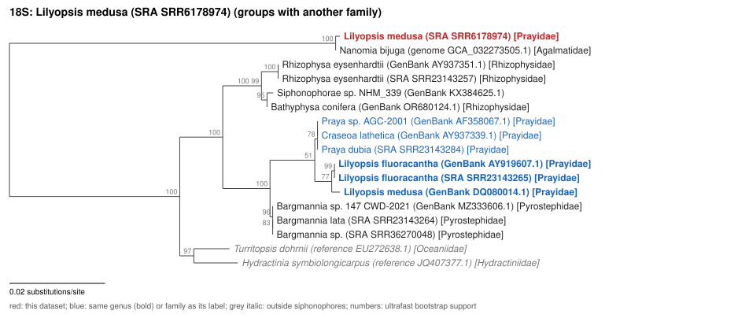

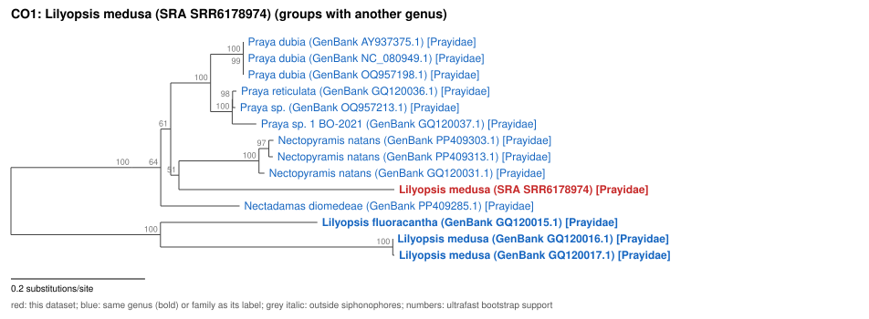

[Back to flagged datasets](#flagged-datasets)

### SRR871528

*Physalia physalis* (Physaliidae), SRA run.

- Record: [SRR871528](https://www.ncbi.nlm.nih.gov/sra/SRR871528)
- ENA: [SRR871528](https://www.ebi.ac.uk/ena/browser/view/SRR871528)
- Library: RNA-Seq, transcriptomic, selection RANDOM, paired, Illumina HiSeq 2000
- Study: Example analysis with automated phylogenomic tools. Transcriptome or Gene expression
- BioProject: [PRJNA205486](https://www.ncbi.nlm.nih.gov/bioproject/PRJNA205486)
- Genes in trees: 28S, CO1

All placements of this dataset's sequences (distances are along the tree, in substitutions per site):

| Gene | Placement | Length (bp) | Aligned sites | Nearest sequence | Distance | Nearest same genus | Nearest same family | Families among nearest |
|---|---|---|---|---|---|---|---|---|
| 28S | consistent | 3263 | 3261 | Physalia (SRA SRR23143271) ([link](https://www.ncbi.nlm.nih.gov/sra/SRR23143271)) | 0.0006 | not checked | 0.0006 | Physaliidae(29) |
| CO1 | **groups with another family** | 691 | 641 | Lilyopsis fluoracantha (GenBank GQ120015.1) ([link](https://www.ncbi.nlm.nih.gov/nuccore/GQ120015.1)) | 0.8988 | 1.1060 | 1.1060 | Diphyidae(2),Prayidae(1),Olindiidae(1),unknown(1) |

[Back to flagged datasets](#flagged-datasets)

### AY935305.1

*Clausophyid sp. 1 CWD-2005* (Clausophyidae), GenBank record.

- Record: [AY935305.1](https://www.ncbi.nlm.nih.gov/nuccore/AY935305.1)
- Title: Clausophyid sp. 1 CWD-2005 16S ribosomal RNA gene, partial sequence; mitochondrial
- Genes in trees: 16S

All placements of this dataset's sequences (distances are along the tree, in substitutions per site):

| Gene | Placement | Length (bp) | Aligned sites | Nearest sequence | Distance | Nearest same genus | Nearest same family | Families among nearest |
|---|---|---|---|---|---|---|---|---|
| 16S | **groups with another family** | 588 | 472 | Calycophorae sp. LC-2017 (GenBank KX374465.1) ([link](https://www.ncbi.nlm.nih.gov/nuccore/KX374465.1)) | 0.0329 | none in tree | 0.3783 | Apolemiidae(4),Agalmatidae(2),unknown(1) |

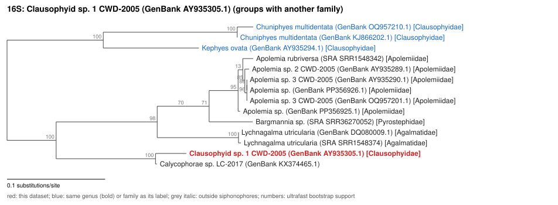

[Back to flagged datasets](#flagged-datasets)

### EU305508.1

*Kephyes ovata* (Clausophyidae), GenBank record.

- Record: [EU305508.1](https://www.ncbi.nlm.nih.gov/nuccore/EU305508.1)
- Title: Clausophyes ovata large subunit 28S ribosomal RNA gene, partial sequence
- Genes in trees: 28S

All placements of this dataset's sequences (distances are along the tree, in substitutions per site):

| Gene | Placement | Length (bp) | Aligned sites | Nearest sequence | Distance | Nearest same genus | Nearest same family | Families among nearest |
|---|---|---|---|---|---|---|---|---|
| 28S | **groups with another family** | 3051 | 3039 | Nanomia bijuga (GenBank PV172466.1) ([link](https://www.ncbi.nlm.nih.gov/nuccore/PV172466.1)) | 0.0017 | not checked | 0.0398 | Agalmatidae(11) |

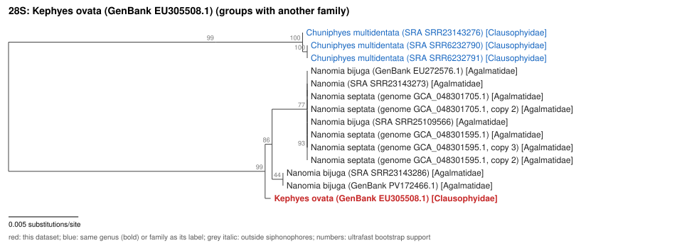

[Back to flagged datasets](#flagged-datasets)

### EU448095.1

*Physalia physalis* (Physaliidae), GenBank record.

- Record: [EU448095.1](https://www.ncbi.nlm.nih.gov/nuccore/EU448095.1)
- Title: Physalia physalis 28S large subunit ribosomal RNA gene, partial sequence
- Genes in trees: 28S

All placements of this dataset's sequences (distances are along the tree, in substitutions per site):

| Gene | Placement | Length (bp) | Aligned sites | Nearest sequence | Distance | Nearest same genus | Nearest same family | Families among nearest |
|---|---|---|---|---|---|---|---|---|
| 28S | **groups with another family** | 3093 | 3078 | Sulculeolaria quadrivalvis (GenBank EU272594.1) ([link](https://www.ncbi.nlm.nih.gov/nuccore/EU272594.1)) | 0.0047 | not checked | 0.1254 | Diphyidae(5),Abylidae(2) |

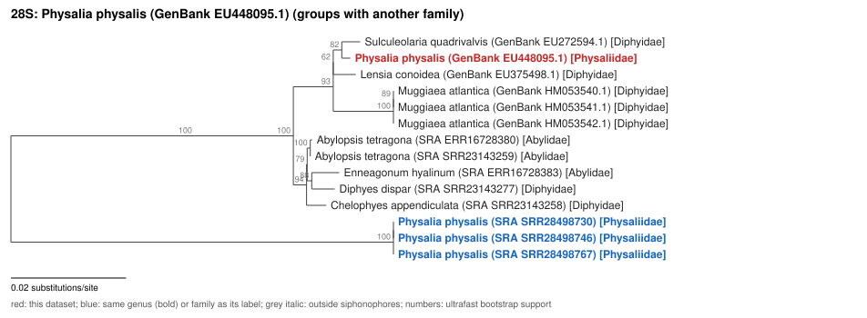

[Back to flagged datasets](#flagged-datasets)

### MZ027186.1

*Apolemiidae environmental sample* (Apolemiidae), GenBank record.

- Record: [MZ027186.1](https://www.ncbi.nlm.nih.gov/nuccore/MZ027186.1)
- Title: Apolemiidae environmental sample voucher prey of Dondersiidae sp.SB-4 ZSM Mol 20190660 large subunit ribosomal RNA gene, partial sequence
- Genes in trees: 28S

All placements of this dataset's sequences (distances are along the tree, in substitutions per site):

| Gene | Placement | Length (bp) | Aligned sites | Nearest sequence | Distance | Nearest same genus | Nearest same family | Families among nearest |
|---|---|---|---|---|---|---|---|---|
| 28S | **groups with another family** | 955 | 949 | Erennidae environmental sample (GenBank MZ027176.1) ([link](https://www.ncbi.nlm.nih.gov/nuccore/MZ027176.1)) | 0.0015 | not checked | 0.0146 | Erennidae(11) |

[Back to flagged datasets](#flagged-datasets)

### MZ027188.1

*Apolemiidae environmental sample* (Apolemiidae), GenBank record.

- Record: [MZ027188.1](https://www.ncbi.nlm.nih.gov/nuccore/MZ027188.1)
- Title: Apolemiidae environmental sample voucher prey of Dondersiidae sp.SB-4 ZSM Mol 20190669 large subunit ribosomal RNA gene, partial sequence
- Genes in trees: 28S

All placements of this dataset's sequences (distances are along the tree, in substitutions per site):

| Gene | Placement | Length (bp) | Aligned sites | Nearest sequence | Distance | Nearest same genus | Nearest same family | Families among nearest |
|---|---|---|---|---|---|---|---|---|
| 28S | **groups with another family** | 962 | 960 | Erennidae environmental sample (GenBank MZ027194.1) ([link](https://www.ncbi.nlm.nih.gov/nuccore/MZ027194.1)) | 0.0005 | not checked | 0.0256 | Pyrostephidae(4),Erennidae(1) |

[Back to flagged datasets](#flagged-datasets)

### MZ027189.1

*Hippopodiidae environmental sample* (Hippopodiidae), GenBank record.

- Record: [MZ027189.1](https://www.ncbi.nlm.nih.gov/nuccore/MZ027189.1)
- Title: Hippopodiidae environmental sample voucher prey of Dondersiidae sp.SB-4 ZSM Mol 20190678 large subunit ribosomal RNA gene, partial sequence
- Genes in trees: 28S

All placements of this dataset's sequences (distances are along the tree, in substitutions per site):

| Gene | Placement | Length (bp) | Aligned sites | Nearest sequence | Distance | Nearest same genus | Nearest same family | Families among nearest |
|---|---|---|---|---|---|---|---|---|
| 28S | **groups with another family** | 957 | 955 | Apolemiidae environmental sample (GenBank MZ027192.1) ([link](https://www.ncbi.nlm.nih.gov/nuccore/MZ027192.1)) | 0.0000 | not checked | 0.0324 | Apolemiidae(3),Erennidae(1),unknown(1) |

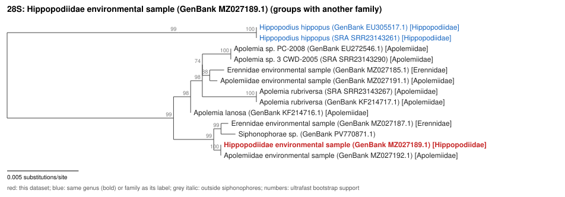

[Back to flagged datasets](#flagged-datasets)

### MZ027190.1

*Apolemiidae environmental sample* (Apolemiidae), GenBank record.

- Record: [MZ027190.1](https://www.ncbi.nlm.nih.gov/nuccore/MZ027190.1)
- Title: Apolemiidae environmental sample voucher prey of Dondersiidae sp.SB-4 ZSM Mol 20190645 large subunit ribosomal RNA gene, partial sequence
- Genes in trees: 28S

All placements of this dataset's sequences (distances are along the tree, in substitutions per site):

| Gene | Placement | Length (bp) | Aligned sites | Nearest sequence | Distance | Nearest same genus | Nearest same family | Families among nearest |
|---|---|---|---|---|---|---|---|---|
| 28S | **groups with another family** | 959 | 957 | Chuniphyes multidentata (SRA SRR23143276) ([link](https://www.ncbi.nlm.nih.gov/sra/SRR23143276)) | 0.0004 | not checked | 0.0269 | Clausophyidae(3),Prayidae(2) |

[Back to flagged datasets](#flagged-datasets)

### MZ027193.1

*Erennidae environmental sample* (Erennidae), GenBank record.

- Record: [MZ027193.1](https://www.ncbi.nlm.nih.gov/nuccore/MZ027193.1)
- Title: Erennidae environmental sample voucher prey of Gymnomeniidae sp.SB-2 ZSM Mol 20190696 large subunit ribosomal RNA gene, partial sequence
- Genes in trees: 28S

All placements of this dataset's sequences (distances are along the tree, in substitutions per site):

| Gene | Placement | Length (bp) | Aligned sites | Nearest sequence | Distance | Nearest same genus | Nearest same family | Families among nearest |
|---|---|---|---|---|---|---|---|---|
| 28S | **groups with another family** | 177 | 176 | Lilyopsis medusa (SRA SRR6178974) ([link](https://www.ncbi.nlm.nih.gov/sra/SRR6178974)) | 0.8835 | not checked | 1.2129 | Agalmatidae(2),Apolemiidae(2),Prayidae(1),Hydractiniidae(1) |

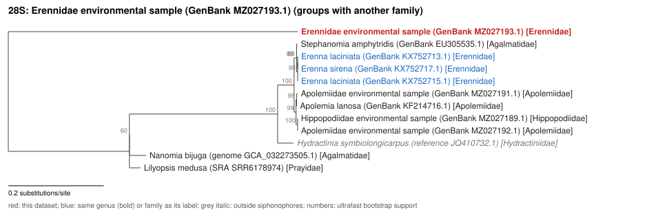

[Back to flagged datasets](#flagged-datasets)

### MZ027194.1

*Erennidae environmental sample* (Erennidae), GenBank record.

- Record: [MZ027194.1](https://www.ncbi.nlm.nih.gov/nuccore/MZ027194.1)
- Title: Erennidae environmental sample voucher prey of Gymnomeniidae sp.SB-2 ZSM Mol 20190698 large subunit ribosomal RNA gene, partial sequence
- Genes in trees: 28S

All placements of this dataset's sequences (distances are along the tree, in substitutions per site):

| Gene | Placement | Length (bp) | Aligned sites | Nearest sequence | Distance | Nearest same genus | Nearest same family | Families among nearest |
|---|---|---|---|---|---|---|---|---|
| 28S | **groups with another family** | 914 | 914 | Apolemiidae environmental sample (GenBank MZ027188.1) ([link](https://www.ncbi.nlm.nih.gov/nuccore/MZ027188.1)) | 0.0005 | not checked | 0.0244 | Pyrostephidae(4),Apolemiidae(1) |

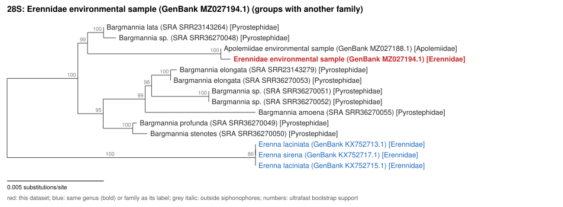

[Back to flagged datasets](#flagged-datasets)

### MZ230467.1

*Dimophyes arctica* (Diphyidae), GenBank record.

- Record: [MZ230467.1](https://www.ncbi.nlm.nih.gov/nuccore/MZ230467.1)
- Title: Dimophyes arctica isolate DA1 large subunit ribosomal RNA gene, partial sequence; mitochondrial
- Genes in trees: 16S

All placements of this dataset's sequences (distances are along the tree, in substitutions per site):

| Gene | Placement | Length (bp) | Aligned sites | Nearest sequence | Distance | Nearest same genus | Nearest same family | Families among nearest |
|---|---|---|---|---|---|---|---|---|
| 16S | **groups with another family** | 540 | 430 | Agalma elegans (GenBank NC_080954.1) ([link](https://www.ncbi.nlm.nih.gov/nuccore/NC_080954.1)) | 0.0000 | none in tree | 0.5925 | Agalmatidae(15) |

[Back to flagged datasets](#flagged-datasets)

### OZ505748.1

*Halistemma rubrum* (Agalmatidae), GenBank record.

- Record: [OZ505748.1](https://www.ncbi.nlm.nih.gov/nuccore/OZ505748.1)
- Title: Halistemma rubrum genome assembly, organelle: mitochondrion
- Genes in trees: 16S, CO1

All placements of this dataset's sequences (distances are along the tree, in substitutions per site):

| Gene | Placement | Length (bp) | Aligned sites | Nearest sequence | Distance | Nearest same genus | Nearest same family | Families among nearest |
|---|---|---|---|---|---|---|---|---|
| 16S | consistent | 703 | 444 | Halistemma rubrum (genome GCA_987347065.1) ([link](https://www.ncbi.nlm.nih.gov/datasets/genome/GCA_987347065.1/)) | 0.0000 | 0.0000 | 0.0000 | Apolemiidae(4),Agalmatidae(1),Prayidae(1) |
| CO1 | **groups with another family** | 597 | 514 | Forskalia tholoides (GenBank AY937370.1) ([link](https://www.ncbi.nlm.nih.gov/nuccore/AY937370.1)) | 10.0224 | 10.4326 | 10.3933 | Forskaliidae(5) |
| CO1 | consistent | 771 | 717 | Halistemma rubrum (GenBank AY937372.1) ([link](https://www.ncbi.nlm.nih.gov/nuccore/AY937372.1)) | 0.0000 | 0.0000 | 0.0000 | Agalmatidae(5) |

Another copy of the same gene from this dataset placed as expected. A foreign copy alongside a consistent one points to contamination in the sequenced material, not to a misidentified specimen.

[Back to flagged datasets](#flagged-datasets)

### PP356949.1

*Rudjakovia sp.* (Agalmatidae), GenBank record.

- Record: [PP356949.1](https://www.ncbi.nlm.nih.gov/nuccore/PP356949.1)
- Title: Rudjakovia sp. isolate SQ19_16S_825E.1 large subunit ribosomal RNA gene, partial sequence; mitochondrial
- Genes in trees: 16S

All placements of this dataset's sequences (distances are along the tree, in substitutions per site):

| Gene | Placement | Length (bp) | Aligned sites | Nearest sequence | Distance | Nearest same genus | Nearest same family | Families among nearest |
|---|---|---|---|---|---|---|---|---|
| 16S | **groups with another family** | 582 | 479 | Erenna insidiator (GenBank KX752719.1) ([link](https://www.ncbi.nlm.nih.gov/nuccore/KX752719.1)) | 0.0913 | none in tree | 0.1406 | Erennidae(8) |

[Back to flagged datasets](#flagged-datasets)

### PP409275.1

*Lensia asymmetrica* (Diphyidae), GenBank record.

- Record: [PP409275.1](https://www.ncbi.nlm.nih.gov/nuccore/PP409275.1)
- Title: Lensia asymmetrica isolate SQ19_16S_101E cytochrome c oxidase subunit I (COX1) gene, partial cds; mitochondrial
- Genes in trees: CO1

All placements of this dataset's sequences (distances are along the tree, in substitutions per site):

| Gene | Placement | Length (bp) | Aligned sites | Nearest sequence | Distance | Nearest same genus | Nearest same family | Families among nearest |
|---|---|---|---|---|---|---|---|---|
| CO1 | **groups with another family** | 516 | 477 | Praya sp. (GenBank OQ957213.1) ([link](https://www.ncbi.nlm.nih.gov/nuccore/OQ957213.1)) | 1.1766 | 1.3105 | 1.2063 | Prayidae(6) |

[Back to flagged datasets](#flagged-datasets)

### PV190284.1

*Maresearsia praeclara* (Prayidae), GenBank record.

- Record: [PV190284.1](https://www.ncbi.nlm.nih.gov/nuccore/PV190284.1)
- Title: Maresearsia praeclara voucher personal collection:MKM:B82:Photo voucher large subunit ribosomal RNA gene, partial sequence; mitochondrial
- Genes in trees: 16S

All placements of this dataset's sequences (distances are along the tree, in substitutions per site):

| Gene | Placement | Length (bp) | Aligned sites | Nearest sequence | Distance | Nearest same genus | Nearest same family | Families among nearest |
|---|---|---|---|---|---|---|---|---|
| 16S | **groups with another family** | 581 | 471 | Apolemia sp. (GenBank PP356925.1) ([link](https://www.ncbi.nlm.nih.gov/nuccore/PP356925.1)) | 0.1019 | none in tree | 0.1801 | Apolemiidae(5) |

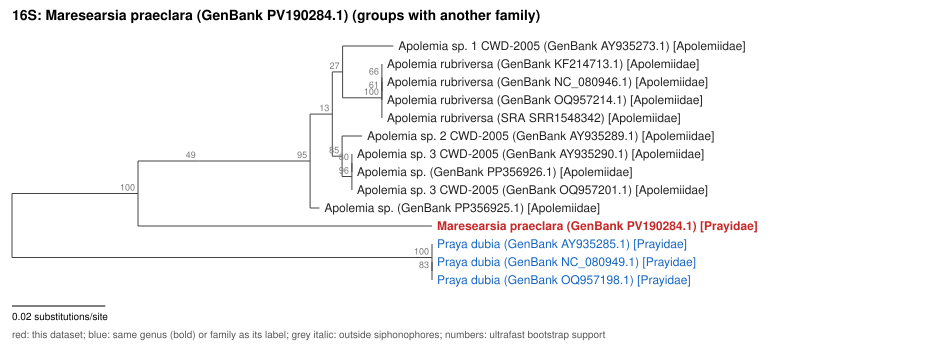

[Back to flagged datasets](#flagged-datasets)

### GQ119992.1

*Halistemma sp. BO-2021* (Agalmatidae), GenBank record.

- Record: [GQ119992.1](https://www.ncbi.nlm.nih.gov/nuccore/GQ119992.1)
- Title: Halistemma sp. BO-2021 voucher Hy048.8.1 cytochrome oxidase subunit I (COI) gene, partial cds; mitochondrial
- Genes in trees: CO1

All placements of this dataset's sequences (distances are along the tree, in substitutions per site):

| Gene | Placement | Length (bp) | Aligned sites | Nearest sequence | Distance | Nearest same genus | Nearest same family | Families among nearest |
|---|---|---|---|---|---|---|---|---|
| CO1 | **groups with another genus** | 1017 | 952 | Physonectae sp. 1 BO-2009 (GenBank GQ119990.1) ([link](https://www.ncbi.nlm.nih.gov/nuccore/GQ119990.1)) | 0.0012 | 0.3546 | 0.0030 | Agalmatidae(5),unknown(1) |

[Back to flagged datasets](#flagged-datasets)

### GQ120022.1

*Halistemma sp. BO-2021* (Agalmatidae), GenBank record.

- Record: [GQ120022.1](https://www.ncbi.nlm.nih.gov/nuccore/GQ120022.1)
- Title: Halistemma sp. BO-2021 voucher Hy048.2. cytochrome oxidase subunit I (COI) gene, partial cds; mitochondrial
- Genes in trees: CO1

All placements of this dataset's sequences (distances are along the tree, in substitutions per site):

| Gene | Placement | Length (bp) | Aligned sites | Nearest sequence | Distance | Nearest same genus | Nearest same family | Families among nearest |
|---|---|---|---|---|---|---|---|---|
| CO1 | **groups with another genus** | 996 | 934 | Nanomia bijuga (GenBank AY937373.1) ([link](https://www.ncbi.nlm.nih.gov/nuccore/AY937373.1)) | 0.0034 | 0.3380 | 0.0034 | Agalmatidae(6) |

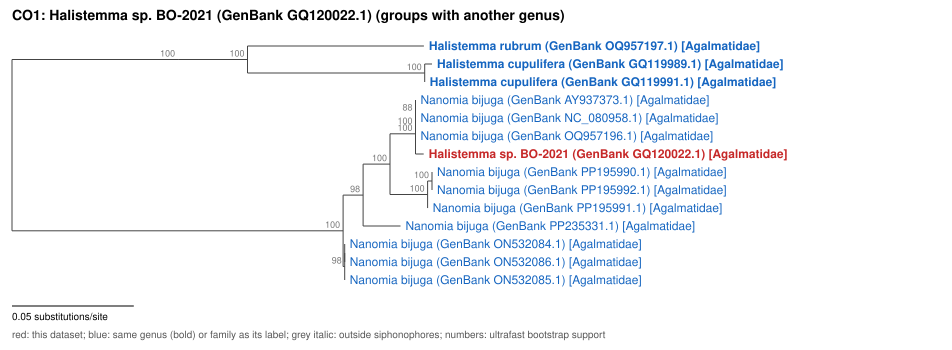

[Back to flagged datasets](#flagged-datasets)

### JX121606.1

*Kephyes ovata* (Clausophyidae), GenBank record.

- Record: [JX121606.1](https://www.ncbi.nlm.nih.gov/nuccore/JX121606.1)
- Title: Clausophyes ovata voucher YPM:35349 cytochrome oxidase subunit I (COI) gene, partial cds; mitochondrial
- Genes in trees: CO1

All placements of this dataset's sequences (distances are along the tree, in substitutions per site):

| Gene | Placement | Length (bp) | Aligned sites | Nearest sequence | Distance | Nearest same genus | Nearest same family | Families among nearest |
|---|---|---|---|---|---|---|---|---|
| CO1 | **groups with another genus** | 508 | 469 | Chuniphyes multidentata (GenBank GQ119964.1) ([link](https://www.ncbi.nlm.nih.gov/nuccore/GQ119964.1)) | 0.0022 | 0.7359 | 0.0022 | Clausophyidae(6) |

[Back to flagged datasets](#flagged-datasets)

### KF962059.1

*Agalma elegans* (Agalmatidae), GenBank record.

- Record: [KF962059.1](https://www.ncbi.nlm.nih.gov/nuccore/KF962059.1)
- Title: Agalma elegans voucher XMAE1 cytochrome oxidase subunit I (COI) gene, partial cds; mitochondrial
- Genes in trees: CO1

All placements of this dataset's sequences (distances are along the tree, in substitutions per site):

| Gene | Placement | Length (bp) | Aligned sites | Nearest sequence | Distance | Nearest same genus | Nearest same family | Families among nearest |
|---|---|---|---|---|---|---|---|---|
| CO1 | **groups with another genus** | 617 | 570 | Nanomia bijuga (GenBank KF977305.1) ([link](https://www.ncbi.nlm.nih.gov/nuccore/KF977305.1)) | 0.0000 | 0.2434 | 0.0000 | Agalmatidae(5) |

[Back to flagged datasets](#flagged-datasets)

### KF962394.1

*Agalma elegans* (Agalmatidae), GenBank record.

- Record: [KF962394.1](https://www.ncbi.nlm.nih.gov/nuccore/KF962394.1)
- Title: Agalma elegans voucher XMAE1 16S ribosomal RNA gene, partial sequence; mitochondrial
- Genes in trees: 16S

All placements of this dataset's sequences (distances are along the tree, in substitutions per site):

| Gene | Placement | Length (bp) | Aligned sites | Nearest sequence | Distance | Nearest same genus | Nearest same family | Families among nearest |
|---|---|---|---|---|---|---|---|---|
| 16S | **groups with another genus** | 481 | 380 | Nanomia bijuga (GenBank KF977401.1) ([link](https://www.ncbi.nlm.nih.gov/nuccore/KF977401.1)) | 0.0000 | 0.1275 | 0.0000 | Agalmatidae(16) |

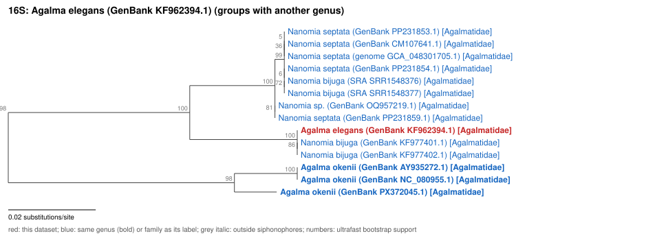

[Back to flagged datasets](#flagged-datasets)

### KJ866199.1

*Muggiaea bargmannae* (Diphyidae), GenBank record.

- Record: [KJ866199.1](https://www.ncbi.nlm.nih.gov/nuccore/KJ866199.1)
- Title: Muggiaea bargmannae isolate G36 16S ribosomal RNA gene, partial sequence; mitochondrial
- Genes in trees: 16S

All placements of this dataset's sequences (distances are along the tree, in substitutions per site):

| Gene | Placement | Length (bp) | Aligned sites | Nearest sequence | Distance | Nearest same genus | Nearest same family | Families among nearest |
|---|---|---|---|---|---|---|---|---|
| 16S | **groups with another genus** | 147 | 133 | Lensia hostile (GenBank KC782551.1) ([link](https://www.ncbi.nlm.nih.gov/nuccore/KC782551.1)) | 0.2340 | 0.6712 | 0.2340 | Diphyidae(6) |

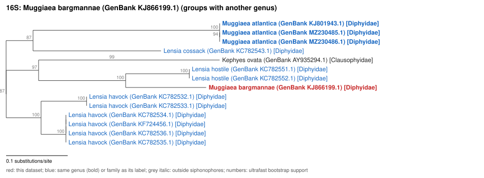

[Back to flagged datasets](#flagged-datasets)

## How to read a flag

Each sequence is compared with its nearest sequences in the gene tree, measured as distance along the branches. Sequences from the same dataset (for example two copies from one genome) are ignored as neighbours. The outcomes are:

| Outcome | Meaning |
|---|---|
| Groups outside siphonophores | Most nearest sequences are not siphonophores, or the nearest one is not and every siphonophore sequence is clearly farther. Typical of contamination (prey, symbionts, other samples) or a non-siphonophore labelled as one. |
| Groups with another family | Sequences of the labelled family are in the tree, none is among the nearest, and the nearest of them is clearly farther than the nearest sequence. |
| Groups with another genus | As above for the labelled genus. Checked only for 16S and CO1. |
| Unresolved | The labelled genus or family is not among the nearest, but is about as close (within the distance margin below). The gene cannot tell them apart here. |
| Consistent | The labelled genus and family are among the nearest sequences. |
| Not evaluable | The label has no genus or family, or it is the only dataset of its genus or family in the tree. |
| Not in tree | The sequence was too short, or kept too few aligned sites after trimming. |

Points to keep in mind:

- **18S and 28S evolve slowly in siphonophores** and often do not differ between genera, so they are checked at family level only. 16S and CO1 are checked at genus and family level.
- **A single flag can have causes other than misidentification**: a genus or family that is not monophyletic, sparse sampling of a group, a short or partial sequence (see *Aligned sites*), or an error in the comparison sequence instead. When two sequences are each other's nearest neighbours and disagree, the tree alone cannot say which is wrong.
- **Agreement across genes and data types is the strongest evidence.** A dataset flagged in several genes, or whose flagged sequence matches an independent dataset of another species, is more likely to be misidentified or contaminated.
- **Genome assemblies can contain DNA of other organisms.** Up to 3 copies of a gene are taken from each assembly. When one copy is foreign and another is consistent, the assembly probably includes contaminating sequence, but its species label is likely correct.
- **Environmental sequences** carry the taxonomy their submitters assigned, which may itself be an inference.
- **Species names** are those of the NCBI Taxonomy entry the data are attached to, and genus and family come from the NCBI lineage.

## Methods

- **Inventory.** NCBI Nucleotide, ENA (raw reads) and NCBI Datasets (genome assemblies) were queried for everything below NCBI Taxonomy ID 42759 (Siphonophorae) on 2026-11-18. Nucleotide records that are pieces of genome assemblies, or shotgun project master records, are listed but not analysed separately, because their assemblies and reads are analysed directly.
- **Gene identification.** Each GenBank record, genome assembly and read-derived sequence was compared with reference marker sequences using BLAST (`blastn -task dc-megablast`, E-value ≤ 1e-10). The references are the sharkmer `hydrozoa` panel sequences and the annotated genes of 9 reference records (NC_080951.1, PZ224405.1, KT809335.1, OQ957212.1, KX421854.1, KX421851.1, EU272566.1, EU272594.1, EU272546.1). Gene names follow one vocabulary (for example 18S, not SSU), with Sequence Ontology and HGNC identifiers.
- **SRA reads.** For each run, marker genes were assembled from the first 2,000,000 reads with sharkmer and its `hydrozoa` primer panel, which targets 18S, 28S, 16S and CO1. Reads were streamed from ENA.
- **Genome assemblies.** Reference markers were searched against each assembly. Up to 3 best-matching copies of each gene were extracted (1 for 16S, 1 for CO1).
- **Gene trees.** For each gene, sequences of at least 1500 (18S), 1500 (28S), 450 (16S), 550 (CO1) bp were aligned with MAFFT, and shorter sequences (down to 100 bp, including short barcodes) were added to that alignment without changing it (`--addfragments --keeplength`). Poorly aligned columns were removed with trimAl (`-automated1`) based on the full-length sequences. Sequences with fewer than 80 remaining sites were left out. Trees were inferred with IQ-TREE (model selection `-m MFP`, 1000 ultrafast bootstrap replicates). A few non-siphonophore hydrozoan reference sequences are included so that foreign sequences have somewhere to go.
- **Placement test.** For each sequence, the 5 nearest sequences from other datasets were found by distance along the tree, plus any tied with the last of them. Flags require the nearest sequence of the labelled group to be farther than the nearest neighbour by at least 0.01 (18S), 0.01 (28S), 0.02 (16S), 0.02 (CO1) substitutions per site; smaller differences are reported as unresolved.
- **Figures** show the flagged sequence with its nearest sequences and the nearest sequences of its labelled genus and family, cut from the full tree with branch lengths kept, and rooted at the midpoint for display. Support values are those of the corresponding branches in the full tree.

The complete workflow is in this repository; [Provenance](#provenance) gives the exact version and settings.

## Unresolved placements

These sequences are not near their labelled genus or family, but the difference is too small for the gene to resolve. They are listed for completeness.

| Gene | Dataset | Labelled as | Family | Nearest sequence | Distance | Nearest same genus | Nearest same family | Note |
|---|---|---|---|---|---|---|---|---|
| 18S | [PV138287.1](https://www.ncbi.nlm.nih.gov/nuccore/PV138287.1) | *Sphaeronectes bougisi* | Sphaeronectidae | Lensia cossack (GenBank MZ230547.1) ([link](https://www.ncbi.nlm.nih.gov/nuccore/MZ230547.1)) | 0.0023 | not checked | 0.0033 | family not resolved by this gene |
| 18S | [KY594837.1](https://www.ncbi.nlm.nih.gov/nuccore/KY594837.1) | *Hippopodiiae sp. 1_UnivF-1183* | Hippopodiidae | Muggiaea atlantica (GenBank MZ230548.1) ([link](https://www.ncbi.nlm.nih.gov/nuccore/MZ230548.1)) | 0.0238 | not checked | 0.0306 | family not resolved by this gene |
| 18S | [KY594854.1](https://www.ncbi.nlm.nih.gov/nuccore/KY594854.1) | *Abylopsis eschscholtzii* | Abylidae | Amphicaryoninae sp. 50_UnivF-1183 (GenBank KY594849.1) ([link](https://www.ncbi.nlm.nih.gov/nuccore/KY594849.1)) | 0.0117 | not checked | 0.0192 | family not resolved by this gene |
| 18S | [DQ080013.1](https://www.ncbi.nlm.nih.gov/nuccore/DQ080013.1) | *Gilia reticulata* | Prayidae | Diphyes dispar (GenBank MZ230452.1) ([link](https://www.ncbi.nlm.nih.gov/nuccore/MZ230452.1)) | 0.0012 | not checked | 0.0047 | family not resolved by this gene |
| 18S | [MZ230531.1](https://www.ncbi.nlm.nih.gov/nuccore/MZ230531.1) | *Dimophyes arctica* | Diphyidae | Kephyes ovata (GenBank AY937336.1) ([link](https://www.ncbi.nlm.nih.gov/nuccore/AY937336.1)) | 0.0006 | not checked | 0.0017 | family not resolved by this gene |
| 18S | [PV849391.1](https://www.ncbi.nlm.nih.gov/nuccore/PV849391.1) | *Hippopodius hippopus* | Hippopodiidae | Crystallophyes amygdalina (GenBank KX421850.1) ([link](https://www.ncbi.nlm.nih.gov/nuccore/KX421850.1)) | 0.0033 | not checked | 0.0062 | family not resolved by this gene |
| 18S | [AY937347.1](https://www.ncbi.nlm.nih.gov/nuccore/AY937347.1) | *Clausophyid sp. 1 CWD-2005* | Clausophyidae | Calycophorae sp. LC-2017 (GenBank KX421849.1) ([link](https://www.ncbi.nlm.nih.gov/nuccore/KX421849.1)) | 0.0006 | not checked | 0.0017 | family not resolved by this gene |
| 18S | [MW272429.1](https://www.ncbi.nlm.nih.gov/nuccore/MW272429.1) | *Athorybia rosacea* | Athorybiidae | Nanomia cara (GenBank PP213759.1) ([link](https://www.ncbi.nlm.nih.gov/nuccore/PP213759.1)) | 0.0010 | not checked | 0.0052 | family not resolved by this gene |
| 18S | [EU880273.1](https://www.ncbi.nlm.nih.gov/nuccore/EU880273.1) | *Resomia dunni* | Resomiidae | Nanomia cara (GenBank PP213758.1) ([link](https://www.ncbi.nlm.nih.gov/nuccore/PP213758.1)) | 0.0017 | not checked | 0.0023 | family not resolved by this gene |
| 28S | [EU305535.1](https://www.ncbi.nlm.nih.gov/nuccore/EU305535.1) | *Stephanomia amphytridis* | Agalmatidae | Erenna laciniata (GenBank KX752713.1) ([link](https://www.ncbi.nlm.nih.gov/nuccore/KX752713.1)) | 0.0039 | not checked | 0.0050 | family not resolved by this gene |
| 28S | [SRR23143263](https://www.ncbi.nlm.nih.gov/sra/SRR23143263) | *Frillagalma vityazi* | Agalmatidae | Erenna laciniata (GenBank KX752713.1) ([link](https://www.ncbi.nlm.nih.gov/nuccore/KX752713.1)) | 0.0077 | not checked | 0.0080 | family not resolved by this gene |
| 28S | [SRR23143268](https://www.ncbi.nlm.nih.gov/sra/SRR23143268) | *Stephanomia amphytridis* | Agalmatidae | Erenna laciniata (GenBank KX752713.1) ([link](https://www.ncbi.nlm.nih.gov/nuccore/KX752713.1)) | 0.0043 | not checked | 0.0050 | family not resolved by this gene |
| 28S | [MZ027185.1](https://www.ncbi.nlm.nih.gov/nuccore/MZ027185.1) | *Erennidae environmental sample* | Erennidae | Apolemiidae environmental sample (GenBank MZ027191.1) ([link](https://www.ncbi.nlm.nih.gov/nuccore/MZ027191.1)) | 0.0015 | not checked | 0.0074 | family not resolved by this gene |
| 28S | [MZ027187.1](https://www.ncbi.nlm.nih.gov/nuccore/MZ027187.1) | *Erennidae environmental sample* | Erennidae | Apolemiidae environmental sample (GenBank MZ027192.1) ([link](https://www.ncbi.nlm.nih.gov/nuccore/MZ027192.1)) | 0.0015 | not checked | 0.0074 | family not resolved by this gene |
| 28S | [MZ027183.1](https://www.ncbi.nlm.nih.gov/nuccore/MZ027183.1) | *Erennidae environmental sample* | Erennidae | Praya dubia (GenBank EU305526.1) ([link](https://www.ncbi.nlm.nih.gov/nuccore/EU305526.1)) | 0.0343 | not checked | 0.0381 | family not resolved by this gene |
| 16S | [SRR871529](https://www.ncbi.nlm.nih.gov/sra/SRR871529) | *Craseoa lathetica* | Prayidae | Apolemia sp. (GenBank PP356925.1) ([link](https://www.ncbi.nlm.nih.gov/nuccore/PP356925.1)) | 0.2051 | 0.2185 | 0.2185 | genus not resolved by this gene; family not resolved by this gene |
| CO1 | [GQ119999.1](https://www.ncbi.nlm.nih.gov/nuccore/GQ119999.1) | *Kephyes ovata* | Clausophyidae | Chuniphyes multidentata (GenBank GQ119965.1) ([link](https://www.ncbi.nlm.nih.gov/nuccore/GQ119965.1)) | 0.7240 | 0.7359 | 0.7240 | genus not resolved by this gene |

## Coverage

Datasets that were listed but not analysed, by reason (for example sequencing platforms other than Illumina and MGI, or data types other than those analysed):

| Source | Reason | Datasets |
|---|---|---|
| GenBank record | assembly_component not processed | 52 |
| GenBank record | project_master not processed | 10 |
| SRA run | no FASTQ at ENA | 1 |
| SRA run | platform ABI_SOLID not short-read | 6 |
| SRA run | platform HELICOS not short-read | 17 |
| SRA run | platform LS454 not short-read | 4 |
| SRA run | platform OXFORD_NANOPORE not short-read | 28 |
| SRA run | platform PACBIO_SMRT not short-read | 13 |
| SRA run | platform PACBIO_SMRT not short-read; no FASTQ at ENA | 6 |
| SRA run | platform PACBIO_SMRT not short-read; strategy Synthetic-Long-Read not selected | 1 |
| SRA run | strategy AMPLICON not selected | 2 |

Marker genes recovered from SRA runs, by library type:

| Library type | Runs analysed | With at least one marker gene | Failed |
|---|---|---|---|
| Hi-C | 5 | 5 | 0 |
| RNA-Seq | 218 | 50 | 1 |
| WGA | 2 | 2 | 0 |
| WGS | 229 | 227 | 2 |

Transcriptome (RNA-seq) runs, especially those with short single-end reads, rarely yield marker genes with this method, so most of them are not in the trees.

Datasets whose analysis failed. These are retried in the next release. sharkmer failures have so far been interrupted or refused downloads from ENA.

| Dataset | Source | Labelled as | Reason |
|---|---|---|---|
| [ERR16828725](https://www.ncbi.nlm.nih.gov/sra/ERR16828725) | SRA run | *Abylopsis tetragona* | sharkmer exited with code 1 |
| [SRR28498802](https://www.ncbi.nlm.nih.gov/sra/SRR28498802) | SRA run | *Physalia physalis* | sharkmer exited with code 1 |
| [SRR40085757](https://www.ncbi.nlm.nih.gov/sra/SRR40085757) | SRA run | *Physalia megalista* | sharkmer exited with code 1 |

## Files

Everything behind this report is in [`data/`](data/):

| File | Contents |
|---|---|
| [`summary.tsv`](data/summary.tsv) | Counts in the summary table. |
| [`dataset_flags.tsv`](data/dataset_flags.tsv) | One row per flagged dataset, with its flags across genes. |
| [`dataset_status.tsv`](data/dataset_status.tsv) | Every dataset listed: metadata, whether it was analysed, genes recovered, genes in trees, flags. |
| `placements_<gene>.tsv` | Every sequence in a gene tree: outcome, nearest sequences, distances. |
| `tips_<gene>.tsv` | Every sequence considered for a gene tree: source, taxonomy, length, and why it was left out, if it was. |
| `tree_<gene>.nwk` | Gene tree (Newick, ultrafast bootstrap support). |
| `alignment_<gene>.fasta.gz` | Alignment before trimming. Sequence names are the internal ids in `tips_<gene>.tsv` (column `seq_id`). |
| `trimal_columns_<gene>.txt` | Alignment columns kept by trimAl (numbered from 0). |
| [`release_record.yaml`](data/release_record.yaml) | Workflow version, tool versions and all settings. |

## Provenance

- Release: 2026-11-18 (data listed by NCBI and ENA on that date)
- Release record written: 2026-11-19 14:15:54+00:00
- Workflow commit: `8a22aaf8715cfb29542a4d129e16fb2b28718aef`
- Tools:
  - snakemake: 9.24.0
  - sharkmer: sharkmer 3.2.1 (https://github.com/caseywdunn/sharkmer)
  - blastn: blastn: 2.17.0+
  - mafft: v7.526 (2024/Apr/26)
  - trimal: trimAl v1.5.rev1 build[2025-11-25]
  - iqtree: IQ-TREE version 3.1.4 for Linux x86 64-bit built Sep 29 2026
  - datasets: datasets version: 18.41.1
- sharkmer panel: hydrozoa (panel_version: 1.0.9)
- All settings: [`data/release_record.yaml`](data/release_record.yaml)

[All releases](../README.md)
